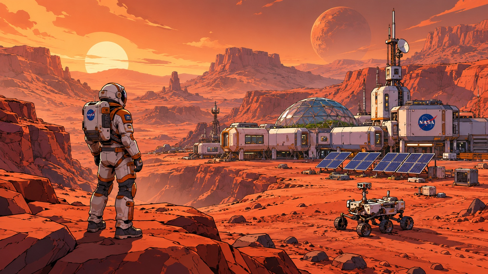

# Mars Exploration: Art Bible

> Documentação oficial de direção artística e concept art, **versão 1.1** (14/11/2026).
> A versão 1.0 foi enviada pelo time em 14/11/2026. As mudanças da 1.1 estão marcadas com **(v1.1)** e justificadas na [seção 21](#21-registro-de-alterações). Estilo, paleta, escala, proporções, iluminação, nível de detalhe e materiais não mudaram.
>
> Divisão de papéis: **este documento define a arte**; a jogabilidade fica em [game-design.md](game-design.md); a forma como a arte vira código (materiais, `PALETTE`) fica em [estilo-visual.md](estilo-visual.md).
> Mudança de arte entra primeiro aqui, com justificativa e nova versão ([seção 19](#19-instruções-para-continuidade-da-direção-artística)).

| Campo | Valor |
| --- | --- |
| Documento | Art Bible & Visual Production Guidelines |
| Versão | 1.1 |
| Data | 14/11/2026 |
| Status | Direção artística inicial estabelecida e alinhada com o design do jogo (v1.1) |
| Projeto | Mars Exploration (primeira missão: Missão Jezero) (v1.1) |
| Gênero | Gestão de base científica em Marte, com exploração pela tripulação e pelo rover (v1.1) |
| Ambientação | Planeta Marte |
| Referência geográfica inicial | Cratera Jezero |
| Modo de jogo | Solo e cooperativo local, de 1 a 5 jogadores (v1.1) |
| Câmera | Cinematográfica em 3/4 sobre a base (v1.1) |
| Tecnologia de destino | Three.js |
| Idioma da documentação | Português brasileiro |

## 1. Apresentação do projeto

Mars Exploration é um projeto de jogo 3D de exploração científica ambientado em Marte.

A experiência coloca o jogador no comando de uma base de pesquisa na Cratera Jezero. A tripulação, o rover e os instrumentos científicos exploram a região, investigam formações geológicas, coletam amostras e registram descobertas. (v1.1)

O universo visual se inspira em dados, fotografias, mapas e pesquisas científicas reais disponibilizados por agências espaciais, especialmente a NASA e a Canadian Space Agency (CSA).

O projeto combina fundamentação científica com liberdade artística e usa uma identidade visual própria.

### 1.1 Objetivo desta documentação

Este documento estabelece as regras oficiais para:

- direção artística;
- identidade visual;
- padrões de modelagem;
- proporções e escalas;
- materiais e superfícies;
- iluminação;
- cores;
- geometria;
- apresentação de concept art;
- fundamentação científica;
- consistência entre diferentes categorias de assets;
- produção e organização das referências visuais.

O documento é a referência central para todas as futuras produções artísticas do Mars Exploration.

**Importante:** o escopo desta documentação é exclusivamente artístico e visual. A implementação técnica, a programação, a arquitetura de software e o desenvolvimento de gameplay ficam fora da produção de concept art.

## 2. Direção artística oficial

### 2.1 Estilo visual escolhido

**Semi-realistic Cel-Shading (Toon Shading).** Esta é a identidade visual oficial do projeto.

A proposta combina:

- formas e proporções semi-realistas;
- geometria natural e reconhecível;
- detalhamento moderado a alto;
- sombras em blocos bem definidos;
- contornos escuros controlados;
- texturas estilizadas;
- iluminação cinematográfica;
- cores naturais com tratamento artístico.

O resultado deve ter a aparência de um jogo 3D estilizado de qualidade cinematográfica.

**Não queremos:**

- aparência excessivamente cartunesca;
- geometria low-poly simplificada demais;
- texturas totalmente fotográficas;
- aparência de desenho 2D;
- contornos grossos demais;
- superfícies plásticas sem diferenciação de materiais;
- cores artificialmente saturadas.

### 2.2 Referência visual principal



A primeira imagem de identidade visual criada para o projeto estabelece esta direção:

- paisagem marciana com cânions e formações rochosas;
- astronauta como referência de escala;
- rover científico;
- estruturas de pesquisa ao fundo;
- iluminação solar cinematográfica;
- paleta de tons avermelhados;
- geometria detalhada, mas estilizada;
- sombras gráficas bem definidas.

Essa imagem é uma referência de identidade visual, não uma representação geográfica cientificamente exata. Todas as próximas artes devem manter coerência com essa linguagem.

> Nota do jogo: os logos da NASA e o planeta gigante no céu que aparecem nesta imagem **não** entram no jogo (ver [12.1](#121-identidade-institucional) e [game-design.md](game-design.md#o-que-não-usar)).

## 3. Paleta de cores

A paleta inicial é a referência para a construção de ambientes, personagens e equipamentos.

| Aplicação | Cor | Hexadecimal |
| --- | --- | --- |
| Solo marciano | Vermelho escuro | `#8E382B` |
| Rochas avermelhadas | Terracota | `#C65B36` |
| Superfícies iluminadas | Laranja quente | `#E58A51` |
| Poeira clara | Areia | `#E6B47A` |
| Sombras profundas | Marrom acinzentado | `#473C3A` |
| Equipamentos tecnológicos | Azul acinzentado | `#718B9A` |
| Superfícies claras | Cinza azulado | `#C8D5D8` |

### 3.1 Regras de utilização

A paleta não deve ser aplicada de maneira rígida. As cores variam conforme:

- a composição aparente do material;
- a iluminação;
- a profundidade;
- a orientação da superfície;
- as condições ambientais;
- a distância do observador.

Os equipamentos tecnológicos podem usar tons frios para criar contraste com o ambiente marciano. Não use cores vibrantes indiscriminadamente.

## 4. Padrões de modelagem

### 4.1 Escala global

Padrão:

- 1 unidade de referência = 1 metro;
- eixo vertical: Y;
- proporções físicas plausíveis;
- escala coerente entre personagens, veículos e ambiente.

O astronauta equipado tem aproximadamente **1,85 m** de altura como referência inicial. As demais dimensões são definidas em proporção a ele.

### 4.2 Filosofia geométrica

A modelagem prioriza, nesta ordem:

1. Silhueta.
2. Proporção.
3. Estrutura.
4. Volume.
5. Detalhamento.
6. Leitura visual.

Evite geometrias simplificadas demais. As formas naturais devem preservar irregularidades e características próprias. Os objetos tecnológicos devem ter componentes identificáveis e uma construção que pareça funcionar.

### 4.3 Níveis de detalhamento

Cada asset é desenvolvido considerando três níveis:

| Nível | Foco | Conteúdo |
| --- | --- | --- |
| LOD conceitual 1 | Silhueta | Representação simplificada para identificação à distância |
| LOD conceitual 2 | Estrutura | Volumes, componentes, articulações e proporções principais |
| LOD conceitual 3 | Superfície | Detalhes, texturas, junções, parafusos, desgaste, materiais e acabamentos |

Esses níveis orientam a produção artística; não são especificações técnicas de implementação.

## 5. Padrão de iluminação

A iluminação se inspira principalmente na luz solar marciana. Características:

- luz direcional principal;
- sombras claramente definidas;
- contraste entre regiões iluminadas e áreas de sombra;
- três a quatro níveis tonais de sombreamento, aproximadamente;
- oclusão de ambiente discreta;
- reflexos controlados;
- profundidade atmosférica;
- iluminação cinematográfica.

A atmosfera deve ajudar a leitura de profundidade sem esconder os detalhes dos elementos principais. Evite iluminação plana demais e sombras completamente pretas.

**Pôr do sol (v1.1):** em Marte, o céu fica de amarelo a laranja, com um halo azulado perto do sol poente, como a Curiosity registrou em 2015 ([NASA/JPL](https://www.jpl.nasa.gov/news/nasas-curiosity-rover-views-serene-sundown-on-mars/)). Durante o dia, o céu segue a cor da poeira.

## 6. Padrões de materiais

### 6.1 Materiais naturais

Categorias: régolito marciano, rochas sedimentares, rochas ígneas, depósitos minerais, poeira, areia e partículas, formações rochosas estratificadas.

Características visuais:

- variações de tonalidade;
- irregularidades;
- desgaste natural;
- superfícies com diferentes níveis de rugosidade;
- pequenos depósitos de poeira;
- camadas geológicas, só quando as referências justificarem.

### 6.2 Materiais tecnológicos

Categorias: metais pintados, ligas metálicas, polímeros técnicos, borrachas, vidros, visores, superfícies fotovoltaicas, componentes estruturais.

Os materiais devem ser visualmente distinguíveis: um componente metálico não pode parecer idêntico a uma superfície plástica.

### 6.3 Desgaste

Os equipamentos devem transmitir uso em ambiente extremo. Considere:

- poeira acumulada;
- pequenos riscos;
- marcas de uso;
- desgaste em pontos de contato;
- variações de tonalidade;
- pequenas imperfeições.

O desgaste não pode atrapalhar a leitura dos componentes.

## 7. Fundamentação científica

A identidade visual do Mars Exploration usa referências científicas verificáveis. A criação artística respeita a distinção entre características comprovadas, interpretações e elementos ficcionais (ver [seção 11](#11-padrão-de-classificação-científica)).

### 7.1 NASA Mars Trek

**Fonte:** <https://trek.nasa.gov/mars/>

Principal referência para geografia e topografia marciana: relevo, crateras, vales, montanhas, depressões, planícies, formações geográficas e localização de ambientes.

Produtos e instrumentos de referência:

- MOLA: Mars Orbiter Laser Altimeter;
- CTX: Context Camera;
- HiRISE: High Resolution Imaging Science Experiment;
- HRSC: High Resolution Stereo Camera.

Os dados de diferentes instrumentos têm resoluções e características distintas. Cada arte deve identificar a fonte e o produto utilizado.

### 7.2 NASA Perseverance

**Fonte:** <https://science.nasa.gov/mission/mars-2020-perseverance/>

Referência para rochas observadas em Marte, formações sedimentares, solo, equipamentos científicos, instrumentos, coleta de amostras e ambientes de exploração.

Instrumentos de interesse: Mastcam-Z, SuperCam, PIXL, SHERLOC e MEDA.

As características dos instrumentos podem inspirar equipamentos do jogo, desde que se mantenha a distinção entre equipamentos reais e designs ficcionais.

### 7.3 NASA Image and Video Library

**Fonte:** <https://images.nasa.gov/>

Biblioteca de referências visuais: fotografias de Marte, imagens de rovers, equipamentos, astronautas, estruturas espaciais e missões científicas.

### 7.4 NASA Open APIs

**Fonte:** <https://api.nasa.gov/>

Portal de acesso programático a dados públicos da NASA, usado como fonte complementar de referências e informações científicas. Nem todos os serviços do portal são específicos de Marte; avalie cada endpoint conforme a finalidade.

### 7.5 DONKI

**Fonte:** <https://ccmc.gsfc.nasa.gov/tools/DONKI/>

Base de eventos de clima espacial. Aplicações conceituais: eventos solares, ejeções de massa coronal, atividade solar, riscos operacionais de missões e contextualização de eventos de radiação.

**Os eventos solares não devem ser convertidos diretamente em valores de dose de radiação na superfície de Marte.** (No jogo, a dose é uma escala própria, classificada como INTERPRETADO; ver [game-design.md](game-design.md#sistemas-e-regras).)

### 7.6 NASA OSDR

**Fonte:** <https://osdr.nasa.gov/bio/repo/>

Repositório de pesquisas em biologia espacial. Aplicações: saúde de astronautas, alterações fisiológicas, estudos de plantas, imunidade, sono, massa muscular e óssea.

Essas pesquisas são referências de biologia espacial, não evidência automática de condições médicas específicas em Marte.

### 7.7 RadLab

**Fonte:** <https://visualization.osdr.nasa.gov/radlab/gui/data-api/>

Banco de dados de dosimetria de radiação. Aplicações: referências de instrumentação, medições de exposição na ISS, equipamentos de dosimetria e contextualização de riscos espaciais.

Medições da ISS devem ser identificadas como dados obtidos em órbita terrestre, nunca apresentadas como medições da superfície marciana.

### 7.8 Canadian Space Agency

**Recursos:**

- <https://www.asc-csa.gc.ca/eng/youth-educators/resources-stem-and-youth-organizations.asp>
- <https://www.asc-csa.gc.ca/eng/youth-educators/toolkits/food-production/>

Uso: agricultura espacial, produção de alimentos, cultivo em ambientes controlados, sistemas de suporte à vida e referências para estruturas agrícolas.

## 8. Região geográfica inicial: Cratera Jezero

**Local de referência:** Cratera Jezero, Marte.

A escolha veio do interesse geológico e científico da região. A área tem evidências de um antigo ambiente lacustre e de um delta fluvial, o que a torna uma referência especialmente interessante para exploração científica.

### 8.1 Elementos geológicos de interesse

- Depósitos sedimentares.
- Formações estratificadas.
- Afloramentos rochosos.
- Regiões de planície.
- Encostas.
- Crateras.
- Depósitos de materiais.
- Transições entre diferentes unidades geológicas.

### 8.2 Regiões conceituais do primeiro ambiente

| Região | Nome | Descrição |
| --- | --- | --- |
| A | Planície de régolito | Terreno aberto, solo avermelhado, pedras dispersas e pequenas irregularidades |
| B | Delta sedimentar | Formações sedimentares, camadas rochosas e estruturas de interesse científico |
| C | Campo rochoso | Concentração de rochas de diferentes tamanhos e formas |
| D | Crateras | Depressões, encostas e paredes rochosas |
| E | Região elevada | Colinas, afloramentos e pontos de observação |

Essas regiões são divisões conceituais para organizar a arte. A localização e a existência de cada uma devem ser verificadas nas referências geográficas antes de serem representadas como áreas reais da Cratera Jezero.

## 9. Categorias oficiais de concept art

Todas as produções usam estes códigos:

| Código | Categoria | Conteúdo |
| --- | --- | --- |
| ENV | Environment | Ambientes e cenários |
| CHR | Character | Personagens |
| VEH | Vehicle | Veículos e rovers |
| ARC | Architecture | Habitats e estruturas |
| PRP | Props | Objetos e equipamentos |
| GEO | Geology | Rochas e formações naturais |
| MAT | Materials | Materiais e texturas |
| FX | Effects | Efeitos ambientais |
| UI | User Interface | Interface visual |

Cada asset recebe um identificador único. Exemplos:

- GEO-001: rocha sedimentar;
- GEO-002: formação rochosa estratificada;
- ENV-001: planície de exploração;
- CHR-001: astronauta principal;
- VEH-001: rover científico;
- ARC-001: habitat de pesquisa.

O registro atual dos assets do protótipo (códigos, classificação e estado) está em [game-design.md](game-design.md#registro-de-assets-do-protótipo).

## 10. Padrão de apresentação das artes

Sempre que o tipo de asset permitir, a documentação visual apresenta:

1. Vista frontal.
2. Vista lateral.
3. Vista traseira.
4. Perspectiva 3/4.
5. Detalhes ampliados.
6. Paleta de cores.
7. Materiais.
8. Escala aproximada.
9. Referências científicas.
10. Observações de modelagem.

As vistas ortográficas preservam as proporções. **A perspectiva 3/4 é a principal apresentação estética.**

Para ambientes, use: vista panorâmica, vista geral, composição de escala, detalhes geológicos e elementos de interesse.

Não use perspectiva que esconda partes importantes do asset.

## 11. Padrão de classificação científica

Toda produção baseada em referências científicas usa uma destas classificações:

| Classificação | Significado | Exemplo |
| --- | --- | --- |
| **REAL** | Diretamente fundamentado em evidência ou documentação científica | Uma formação geológica observada em imagens de uma missão marciana |
| **INTERPRETADO** | Baseado em evidências reais, mas adaptado visualmente | Uma formação rochosa real reproduzida com volumes simplificados e cores estilizadas |
| **FICCIONAL** | Criado para o universo do jogo | Um habitat futurista projetado para a missão |

Não apresente elementos ficcionais como descobertas científicas reais.

## 12. Padrão de identidade dos equipamentos

Os equipamentos apresentam:

- construção modular;
- componentes identificáveis;
- proporções plausíveis;
- compartimentos;
- sensores;
- articulações;
- conectores;
- cabos;
- superfícies de proteção;
- identificação visual consistente.

O design deve transmitir funcionalidade. Não use elementos tecnológicos decorativos sem considerar sua função visual.

Equipamentos reais podem servir de inspiração, mas a reprodução deve respeitar a classificação científica e as condições de uso das respectivas referências.

### 12.1 Identidade institucional

Não adicione automaticamente logotipos da NASA ou de outras agências. O uso de marcas, símbolos e identificações institucionais deve respeitar as diretrizes oficiais e não pode sugerir patrocínio, parceria ou endosso institucional. (No jogo, a missão usa o emblema próprio "JZ-1".)

## 13. Padrão de consistência entre as artes

Todas as categorias compartilham:

- linguagem de contorno;
- intensidade de sombreamento;
- densidade de detalhes;
- filosofia de materiais;
- paleta;
- abordagem de iluminação;
- proporções;
- nível de realismo.

Um astronauta, um rover e um habitat criados separadamente devem parecer pertencer ao mesmo universo visual.

A primeira arte de identidade visual ([2.2](#22-referência-visual-principal)) é a referência estética geral do projeto. Não modifique a direção artística sem registrar a mudança nesta Art Bible.

## 14. Padrão de produção dos concepts

Cada nova produção segue este fluxo:

1. **Definição:** identificar o asset, sua categoria e a finalidade visual.
2. **Pesquisa:** buscar referências reais e confiáveis.
3. **Fundamentação:** registrar quais características são reais, interpretadas ou ficcionais.
4. **Concepção:** definir silhueta, proporções, volumes, materiais e cores.
5. **Produção:** gerar a arte respeitando a identidade visual oficial.
6. **Refinamento:** corrigir inconsistências de proporção, iluminação, geometria e detalhes.
7. **Aprovação:** verificar os [critérios de qualidade](#16-critérios-oficiais-de-aprovação).
8. **Documentação:** registrar a versão aprovada e suas referências.

## 15. Padrão de prompts para geração de imagens

Todos os prompts consideram a identidade visual oficial.

### 15.1 Direção visual base

Use como orientação:

```text
High-quality semi-realistic cel-shaded 3D video game concept art, realistic natural proportions,
stylized detailed geometry, controlled dark outlines, clearly defined stepped toon shadows,
cinematic directional sunlight, natural material variation, carefully controlled color palette,
detailed environmental forms, cohesive stylized game art direction.
```

### 15.2 Restrições visuais

Evitar:

```text
Photorealistic rendering. Flat cartoon illustration. Excessive low-poly geometry.
Oversaturated colors. Excessively thick black outlines. Inconsistent lighting.
Uncontrolled surface noise. Inconsistent object proportions.
Unnecessary science-fiction ornamentation.
```

### 15.3 Prompts específicos

Complemente a direção visual base com informações específicas de cada asset:

| Categoria | Priorizar |
| --- | --- |
| GEO | Composição, estrutura e características geológicas |
| CHR | Anatomia, traje, proporções e componentes |
| VEH | Construção mecânica, dimensões e funcionalidade |
| ARC | Arquitetura, materiais, escala e integração ambiental |
| ENV | Composição, topografia, profundidade e distribuição de elementos |

## 16. Critérios oficiais de aprovação

Antes de considerar uma arte finalizada, verifique:

- [ ] Direção semi-realista com cel-shading respeitada.
- [ ] Proporções coerentes.
- [ ] Silhueta identificável.
- [ ] Materiais distinguíveis.
- [ ] Paleta consistente.
- [ ] Iluminação coerente.
- [ ] Geometria legível.
- [ ] Detalhamento adequado.
- [ ] Fundamentação científica registrada, quando aplicável.
- [ ] Classificação REAL, INTERPRETADO ou FICCIONAL.
- [ ] Nenhuma inconsistência com assets anteriores.
- [ ] Qualidade suficiente para servir como referência de modelagem.

## 17. Organização e versionamento

Cada asset tem: código, nome, categoria, versão, data, descrição, referências, classificação científica e estado de aprovação.

| Estado | Significado |
| --- | --- |
| CONCEPT | Ideia inicial |
| WIP | Em desenvolvimento |
| REVIEW | Aguardando avaliação |
| APPROVED | Aprovado |
| SUPERSEDED | Substituído por uma versão posterior |

As versões anteriores são preservadas para rastreabilidade.

> No repositório: concept art aprovada vai em `docs/img/concept/<código>-v<versão>.<ext>` (ex.: `CHR-001-v1.png`), e o estado é atualizado no [registro de assets](game-design.md#registro-de-assets-do-protótipo). Arquivos-fonte pesados (`.psd`, `.blend`) ficam no drive do time ([convencoes.md](convencoes.md#assets)).

## 18. Roadmap de produção artística

Ordem inicial recomendada:

| Fase | Categoria | Itens |
| --- | --- | --- |
| 1 | GEO: Geologia marciana | Rochas sedimentares, rochas isoladas, agrupamentos rochosos, afloramentos, solo e régolito, depósitos de poeira, crateras, formações geológicas |
| 2 | ENV: Ambientes | Planícies, delta sedimentar, campos rochosos, encostas, crateras, paisagens panorâmicas, pontos de observação |
| 3 | CHR: Personagem | Astronauta principal, traje espacial, capacete, mochila, equipamentos pessoais, prancha de vistas ortográficas, detalhes dos componentes |
| 4 | VEH: Veículos | Rover científico, sistema de rodas, suspensão, sensores, instrumentos, compartimentos |
| 5 | ARC: Arquitetura | Habitat, laboratório, estação científica, antenas, sistemas solares, estruturas auxiliares |
| 6 | PRP, MAT e FX | Equipamentos científicos, instrumentos de coleta, ferramentas, materiais, poeira, partículas, efeitos atmosféricos |

## 19. Instruções para continuidade da direção artística

Esta documentação é a referência oficial do Mars Exploration. Toda nova arte respeita as regras estabelecidas. Quando uma nova decisão artística for aprovada, ela é incorporada a este documento.

Não altere silenciosamente:

- estilo visual;
- paleta;
- escala;
- proporções;
- linguagem de iluminação;
- nível de detalhamento;
- padrão de materiais.

Quando uma alteração for necessária, registre a justificativa na [seção 21](#21-registro-de-alterações) e atualize a versão da Art Bible.

A consistência visual entre os assets é mais importante do que a inovação isolada de cada imagem.

## 20. Diretriz final

O Mars Exploration deve construir uma identidade visual reconhecível, consistente e fundamentada cientificamente. A liberdade artística transforma informações reais numa experiência visual envolvente, sem perder a conexão com as características observáveis de Marte.

**Princípio central do projeto:**

> Ciência real como fundamento. Interpretação artística como linguagem. Consistência visual como identidade.

## 21. Registro de alterações

| Versão | Data | Alteração | Justificativa |
| --- | --- | --- | --- |
| 1.1 | 14/11/2026 | Cabeçalho: gênero, modo de jogo e câmera | Alinhamento com o documento de design, que segue o desafio do Space Apps: gestão de base, solo e cooperativo. A Art Bible define a arte; a jogabilidade fica no design ([seção 1.1](#11-objetivo-desta-documentação)) |
| 1.1 | 14/11/2026 | Cabeçalho: projeto Mars Exploration, primeira missão Missão Jezero | Nome decidido pelo time |
| 1.1 | 14/11/2026 | Seção 1: papel do jogador | Mesmo motivo da mudança de gênero |
| 1.1 | 14/11/2026 | Seção 5: céu do pôr do sol | Fundamentação científica: pôr do sol azulado registrado pela Curiosity em 2015 |
| 1.2 | 15/11/2026 | ARC-002: a estufa deixa de ser uma cúpula de vidro e passa a ser fechada, do mesmo material das cápsulas (casco, faixas e nervuras), com anel de regolito, concentrador solar com fibra óptica e LEDs de cultivo | Fundamentação científica: a estufa da NASA não é de vidro, ficaria sob o regolito por causa da radiação e recebe luz por fibra óptica e LED ([ciencia-marte.md](ciencia-marte.md), F20). Mesmo material das cápsulas por escolha do time, para a base ser coerente. A translucidez segue a convenção de ver através dos módulos |
| 1.0 | 14/11/2026 | Direção artística inicial | — |
