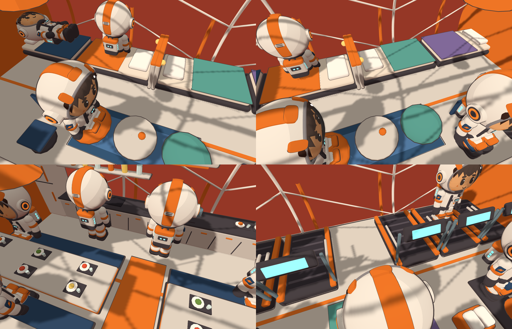
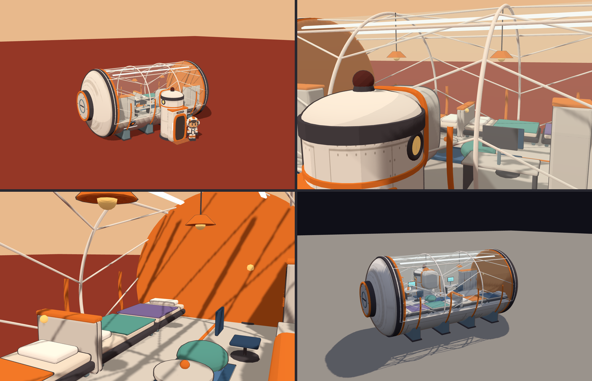
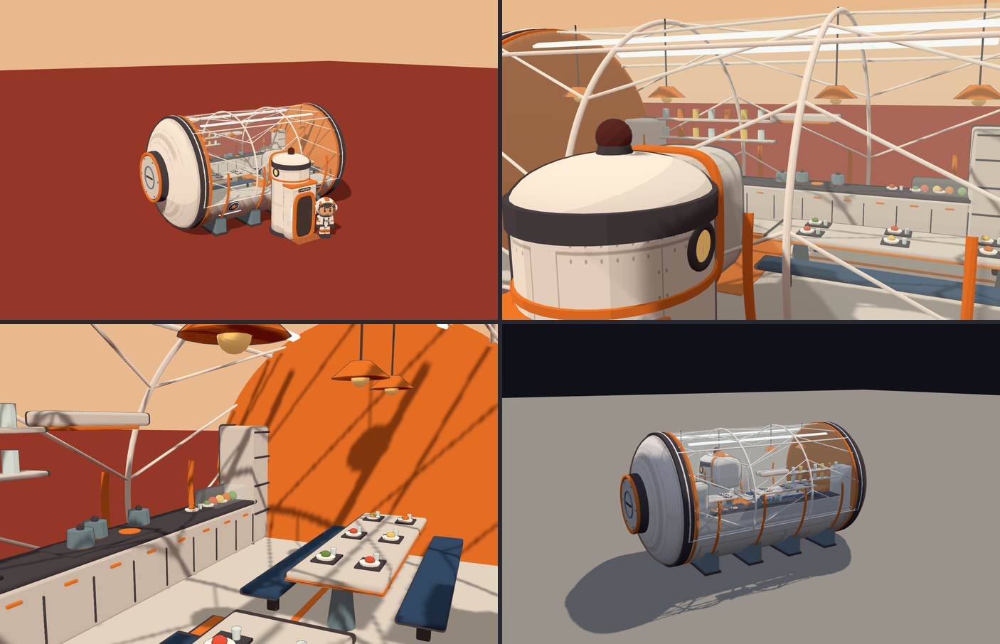
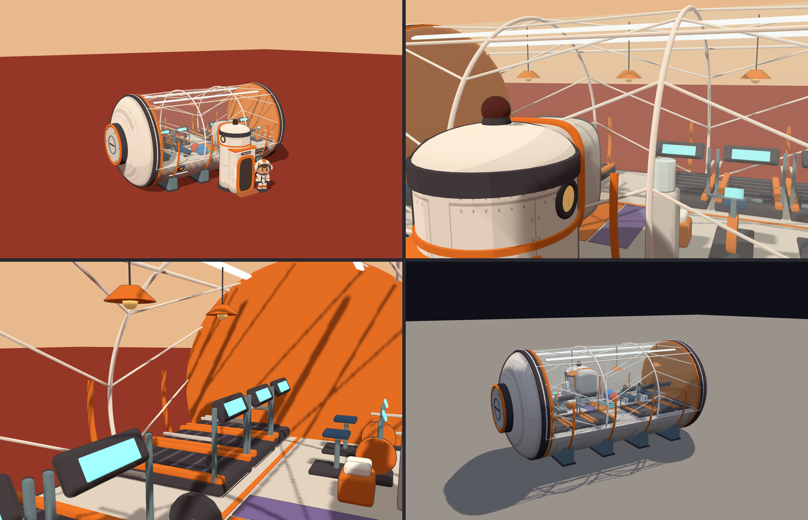

# Blocos de vidro: dormitório, refeitório e academia (GLB)

Três blocos da base (os mesmos na Lua e em Marte), todos **cilindros grandes e transparentes**, com vidro e treliça como os da estufa, e móveis por dentro. Escala: 1 unidade = 1 m; astronauta = 1,85 m. Origem no chão, no centro do bloco. Eixo comprido em X; frente (porta) em +Z. Fontes em `art-source/scenery/` (casco compartilhado em `models/GlassCylinder.ts`).

## Casco (igual nos três)

- Cilindro de **5,2 m de diâmetro** (raio 2,6 m), com o eixo na altura das portas de acoplamento (2,65 m). Por isso liga direto nos outros blocos.
- Trecho reto de vidro com treliça (anéis, diagonais e vigas) entre duas tampas opacas em cúpula; a barriga, abaixo do piso, é opaca.
- Piso interno a 1,72 m (altura das escotilhas), com 4,7 m de largura; pé-direito de 3,5 m no meio.
- O bloco se apoia em 4 selas com cintas laranja (`saddle_0..3`), em vez das pernas dos blocos pequenos.
- Porta de entrada no chão (`hatch_door`, 1,0 x 1,95 m), no tubo de acesso, que fica **1,0 m mais à frente** que o dos blocos pequenos. O astronauta entra em `(0, 0, 5,1)` e some.
- Portas de acoplamento `port_a` (-X) e `port_b` (+X), na mesma altura e do mesmo tamanho das da Base de Pesquisa.
- Luz de alerta `alarm_light` (material `alarm`) no tubo de acesso; vidro no material `dome_glass`; lâmpadas de dentro no material `window` (acendem à noite); faixas de LED no material `base_lights`.

| Arquivo | Bloco | Tamanho (porta a porta) | Dentro |
|---|---|---|---|
| `dormitory.glb` | Dormitório | 11,2 m (trecho de vidro de 9 m) | 4 camas de solteiro, uma por tripulante (`bed_0..3`), 6 armários (`locker_0..5`), 2 mesas de estudo com tela e cadeira (`desk_0..1`), área de leitura com mesinha e 2 pufes (`beanbag_0..1`), abajures e luminárias |
| `refectory.glb` | Refeitório | 10,2 m (trecho de vidro de 8 m) | 2 mesas compridas com bancos, 12 lugares (`table_0..1`), cozinha (`kitchen`: 2 pias, fogão de 4 bocas, coifa, balcão de servir, vitrine, prateleiras), geladeira (`fridge`), despensa (`pantry`), bebedouro, 4 luminárias |
| `gym.glb` | Academia | 11,2 m (trecho de vidro de 9 m) | 6 esteiras largas (`treadmill_0..5`), 2 bancos de supino (`bench_press_0..1`), 2 bicicletas (`bike_0..1`), 2 estantes de halteres, 3 tapetes de yoga (`mat_0..2`), 2 bolas, bebedouro, toalhas, 3 luminárias |

## Escala dos móveis (para o personagem interagir)

Os móveis seguem as medidas do astronauta: 1,87 m de altura, capacete de 1,03 m de largura e 0,87 m de profundidade, quadril a 0,55 m, ombro a 0,95 m.

| Peça | Medida |
|---|---|
| Assentos (bancos, cadeiras, beirada da cama) | 0,33 m |
| Tampo das mesas | 0,58 m (o capacete passa por cima) |
| Colchão | 0,36 m de altura, 2,15 x 1,25 m (cabe deitado com o capacete inteiro) |
| Balcão da cozinha | 0,70 m (abaixo do ombro) |
| Esteira | 1,1 x 1,9 m, correia de 0,82 m, corrimãos a 0,75 m de altura e a 0,55 m do meio (por fora dos braços) |
| Bicicleta | selim a 0,60 m, guidão a 0,85 m |
| Supino | banco a 0,30 m, barra a 0,95 m |
| Corredores | pelo menos 1 m livre (largura do capacete) |

Cada móvel tem **pontos de interação**: nós vazios (`Object3D`) onde o jogo encaixa o personagem. A posição do nó é onde fica a origem do personagem (os pés, ou o quadril quando sentado) e o +Z local do nó é para onde ele olha. Nos pontos `_lie`, o nó fica no meio do colchão ou do banco e o personagem deita de barriga para cima, com a cabeça para o -X local (cama) ou para o -Z local (supino).

| Bloco | Pontos de interação |
|---|---|
| Dormitório | `bed_N_sit`, `bed_N_lie`, `desk_N_sit`, `locker_N_use`, `beanbag_N_sit` |
| Refeitório | `table_N_seat_K` (K = 0 a 5), `kitchen_sink_use`, `kitchen_stove_use`, `kitchen_serve_use`, `fridge_use`, `pantry_use`, `cooler_use` |
| Academia | `treadmill_N_run`, `bike_N_ride`, `bench_press_N_lie`, `mat_N_use`, `dumbbell_rack_N_use`, `cooler_use` |

A treliça do vidro é leve (anéis a cada ~3 m e diagonais espaçadas e finas) para deixar o interior bem visível.

## Animação

`gym.glb` tem o clipe `treadmills_run` (1,2 s, em laço): as listras de cada correia (`treadmill_N_stripe_K`) correm de +Z para -Z, como se alguém corresse olhando para +Z. É só visual; o jogo decide quando tocar. Os outros dois blocos não têm clipes.

## Para o jogo

Materiais que o jogo pode procurar pelo nome: `dome_glass`, `window`, `base_lights`, `alarm`, `label`, `treadmill_screen`, mais as plaquinhas `label_dormitorio`, `label_refeitorio` e `label_academia`.

Ao trocar o material por toon, preservar `name`, `emissive`, transparência, `map`, `alphaTest` e `vertexColors`. Contorno: `userData.outline` (0 = sem contorno).

Atenção: o casco (5,2 m de diâmetro) é mais largo que o da estufa e da base de pesquisa (3,2 m), mas as portas de acoplamento têm o mesmo tamanho e a mesma altura. Ao ligar blocos, basta alinhar os eixos (2,65 m).

## Prévias

