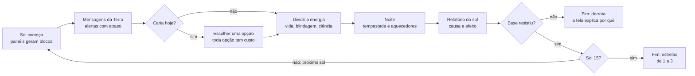
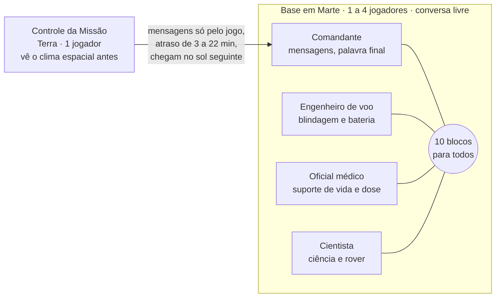
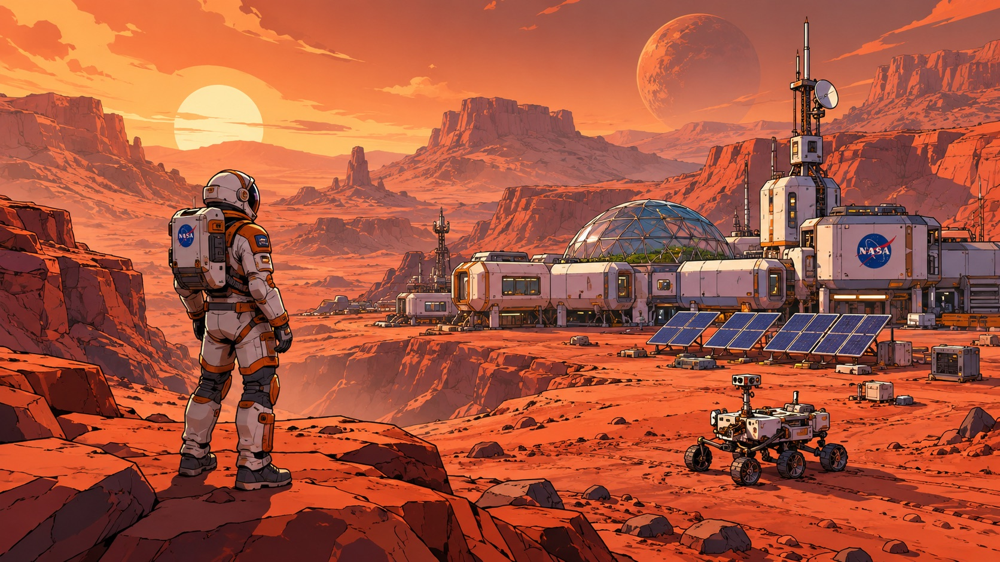
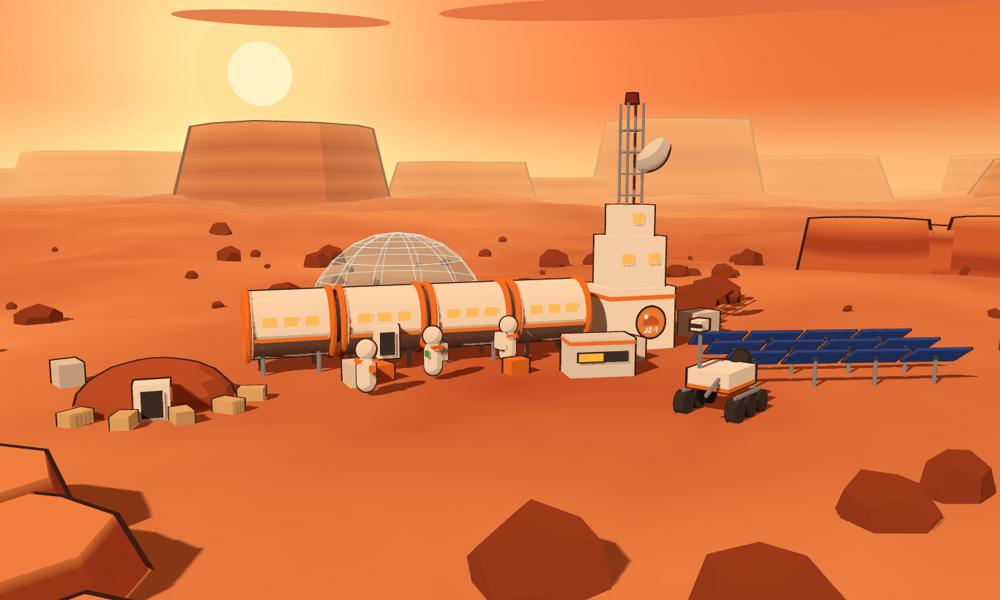
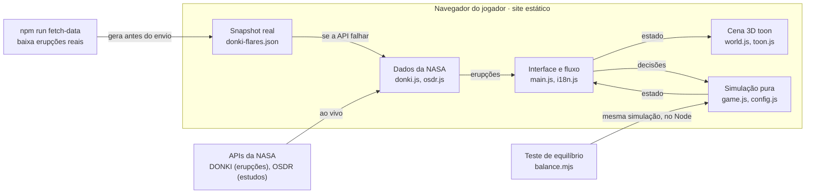

# Mars Exploration: Missão Jezero: documento de design do jogo (GDD)

> Documento vivo. Origem: GDD do time ("Tab 1"), versão de 14/11/2026, que substitui o rascunho "Base Marte Pi" (ver o histórico do git).
> Requisitos do desafio: [desafio.md](desafio.md). Mudou uma regra do jogo? Atualize aqui no mesmo PR; todo número real precisa de fonte.
> Este guia define a **jogabilidade**. A **arte** é definida pela Art Bible (documento externo do time).
> Mudança de jogabilidade entra primeiro aqui; mudança de arte entra primeiro na Art Bible (ver [Alinhamento com a Art Bible](#alinhamento-com-a-art-bible)).

## Visão geral

Mars Exploration: Missão Jezero é um jogo de navegador. Nele, uma criança de 7 a 12 anos comanda uma base em Marte por 15 sóis. Para vencer, ela precisa dividir uma energia limitada entre sobreviver e fazer ciência.

| Item | Definição |
| --- | --- |
| Desafio | [Build a Junior Astronaut Mission Trainer](https://www.spaceappschallenge.org/2026/challenges/junior-astronaut-mission-trainer/), NASA Space Apps Challenge 2026 (14 e 15 de novembro) |
| Público | Crianças de 7 a 12 anos; também serve para pais e sala de aula |
| Plataforma | Navegador, sem download e sem conta; computador e celular |
| Local da missão | Cratera Jezero, Marte |
| Duração de uma partida | 15 sóis, cerca de 10 a 15 minutos |
| Jogadores | 1 no modo solo; de 2 a 5 no modo cooperativo, no mesmo aparelho (planejado) |
| Idiomas | Português e inglês |
| Protótipo atual | [Missão Jezero, versão jogável](https://claude.ai/artifact/N2MTXT1A145mwDge8USXFC) |

**Frase do jogo:** "Cada bloco de energia que você guarda hoje é o que mantém sua tripulação viva esta noite."

O desafio pede um protótipo funcionando que mostre uma troca real de engenharia com clareza. A criança deve sair entendendo uma restrição verdadeira da sobrevivência no espaço, e não só ter jogado algo divertido.

## Objetivos de aprendizagem

Ao fim de uma partida, a criança deve conseguir explicar com as próprias palavras estas quatro trocas reais de uma missão:

1. **Energia é limitada e a noite cobra a conta.** Os painéis só geram energia de dia; o que não for guardado na bateria falta à noite.
2. **Proteção custa caro, mas a falta de proteção custa a missão.** Reforçar a blindagem tira energia da ciência, mas uma tempestade solar sem blindagem pode encerrar a missão.
3. **A Terra está longe.** Mensagens levam de 3 a 22 minutos entre a Terra e Marte, e às vezes a equipe precisa decidir sozinha.
4. **Jogar só no seguro também falha.** A missão existe para fazer ciência; sobreviver sem descobrir nada dá só 1 estrela.

Termos científicos que o jogo explica no contexto, nunca de antemão: sol (dia marciano), dose de radiação, blindagem, regolito, erupção solar.

## Loop de jogo

Todo sol tem uma única decisão obrigatória: dividir a energia. Cartas aparecem em alguns sóis, e o jogo só termina quando a base cai ou quando o sol 15 acaba.



## Sistemas e regras

São três recursos centrais (energia, suporte de vida e blindagem), seguindo o conselho do desafio de não passar de 2 ou 3. A dose de radiação é a consequência, e a ciência é o objetivo.

**Energia em blocos.** A cada sol, os painéis geram 10 blocos de energia (no mínimo 2 com muita poeira). O jogador distribui os blocos entre suporte de vida, blindagem e ciência; o que sobra vai para a bateria.

| Recurso | Começa em | Regra por sol | Limite |
| --- | --- | --- | --- |
| Bateria | 50 | +10 por bloco que sobra; a noite gasta 20 | Máximo 100. Se faltar energia à noite, o suporte de vida perde 0,6 por ponto que faltou |
| Suporte de vida (ar, água, comida) | 70 | Precisa de 3 blocos para ficar estável; cada bloco a mais ou a menos muda 6 | Em 0, a missão termina |
| Blindagem | 40 | Perde 4 por desgaste; ganha 8 por bloco | Máximo 100 |
| Dose de radiação | 0 | +1 por sol, mesmo sem tempestade | Em 100, a tripulação volta para a Terra |
| Ciência | 0 | +3 por bloco; metade disso no sol de tempestade | Meta: 100 |
| Poeira nos painéis | 0% | Cai 6 pontos percentuais por sol com vento | Máximo 80%; reduz os blocos gerados na mesma proporção |

**Tempestade solar.** Uma erupção real do DONKI dispara o evento e define a intensidade dele no jogo: classe C = fraca (10), M = média (25), X = forte (45). A dose recebida é calculada assim:

```
dose = max(1, round(intensidade × (1 − blindagem / 100 × 0,85)))
```

Essa é uma escala do jogo, classificada como INTERPRETADO, e não a dose real na superfície de Marte. O jogo informa isso ao jogador.

Todos esses números são simplificados para o jogo e ficam em um único arquivo de configuração (no protótipo, `src/sim/config.js`). O que é real é a erupção, não a escala da dose (Art Bible, seção 7.5).

## Eventos e decisões

Cada partida sorteia 3 tempestades solares, 1 tempestade de poeira e 4 das 6 cartas de decisão. Assim, nenhuma partida é igual à outra, o que incentiva a criança a testar estratégias diferentes.

**Tempestade solar e atraso de comunicação.** O alerta chega pela antena um sol antes do impacto. Ele diz a classe da erupção e quantos minutos a mensagem levou para chegar (sorteado entre 3 e 22). No sol do impacto, um segundo aviso lembra que é a última chance de reforçar a blindagem. As tempestades acontecem entre o sol 4 e o sol 14, com pelo menos 2 sóis de distância entre elas.

**Tempestade de poeira.** Soma 40 pontos percentuais de poeira nos painéis. A poeira fica assim por 3 sóis antes de o vento começar a limpar.

**Cartas de decisão.** Toda opção tem um custo, direto ou de oportunidade. Nenhuma escolha sai de graça. Uma carta aparece no começo do sol e precisa ser respondida antes de o jogador planejar a energia.

| Carta | Opção A | Opção B | Opção C | O que ensina |
| --- | --- | --- | --- | --- |
| Painéis empoeirados (a carta já soma 25% de poeira) | Astronauta limpa: poeira −30%, dose +4 | Esperar o vento: nada muda agora | — | Sair da base expõe à radiação |
| Rocha misteriosa | Mandar o rover: ciência +15, bateria −20 | Deixar para lá | — | Ciência gasta energia |
| Vazamento na estufa | Consertar agora: bateria −15, ciência −5 | Consertar depois: vida −15 | — | Adiar um reparo cobra mais caro |
| Nave de carga | Baterias: bateria +30 | Kit de blindagem: blindagem +30 | Experimento: ciência +15 | Espaço de carga é limitado |
| Sensor quebrado | Pedir ajuda à Terra: ciência −10 | Consertar sozinhos: 50% de chance de dar errado (bateria −20) | — | Atraso de comunicação força decisões autônomas |
| Gelo no subsolo | Perfurar: bateria −20, vida +20 | Agora não | — | Recursos locais custam energia para extrair |

## Vitória, derrota e estrelas

A missão termina bem quando a base chega viva ao fim do sol 15. A nota de 1 a 3 estrelas mede o quão bem a missão foi cumprida.

| Resultado | Condição |
| --- | --- |
| Derrota: sem ar e água | Suporte de vida chega a 0 |
| Derrota: radiação demais | Dose chega a 100 |
| 1 estrela | Sobreviveu os 15 sóis |
| 2 estrelas | Sobreviveu e fez pelo menos 100 de ciência |
| 3 estrelas | Sobreviveu, fez 100 de ciência e terminou com dose abaixo de 50 |

A derrota não pode parecer castigo. A tela final explica o que aconteceu, lista o que astronautas de verdade também enfrentam e oferece jogar de novo com eventos novos.

**Equilíbrio esperado.** Testado com 2.000 partidas simuladas por estratégia (`npm run balance`):

| Estratégia | Resultado |
| --- | --- |
| Só ciência, sem guardar bateria | Perde sempre: a bateria acaba à noite |
| Só segurança, sem ciência | Sempre sobrevive, sempre 1 estrela |
| Ignora a blindagem | Perde 31% das vezes por radiação |
| Reage aos alertas e guarda reserva | Sempre sobrevive, 80% das vezes com 3 estrelas |

Qualquer mudança nos números deve manter essa forma: as duas estratégias extremas falham e a estratégia atenta vence.

## Modo cooperativo

O jogo aceita de 1 a 5 jogadores no mesmo aparelho, com duas camadas de cooperação:

- a Terra coopera com Marte só por mensagens com atraso;
- os papéis em Marte cooperam dividindo a mesma energia.

As duas camadas vêm de como a NASA treina tripulações para Marte.



A Terra sabe do clima espacial antes, mas não decide. Marte decide, mas recebe os avisos atrasados. Um precisa do outro.

| Camada | Quem coopera | Como se comunicam | O que ensina |
| --- | --- | --- | --- |
| Terra ↔ Marte | Controle da Missão e tripulação | Só por mensagens dentro do jogo, com atraso | Comunicação lenta; a tripulação às vezes decide sozinha |
| Dentro de Marte | Comandante, engenheiro de voo, oficial médico e cientista | Conversando livremente, porque estão juntos na base | Um orçamento só para todos: cada papel puxa para o seu lado e o grupo negocia |

### Modos por número de jogadores

| Jogadores | Terra | Marte |
| --- | --- | --- |
| 1 | Automática (como hoje) | Um jogador controla tudo |
| 2 | 1 jogador | 1 jogador controla os quatro papéis |
| 3 a 5 | 1 jogador | 2 a 4 jogadores dividem os papéis; com menos de 4, alguém acumula papéis |

### Papéis em Marte

| Papel | Cuida de | Quer |
| --- | --- | --- |
| Comandante | Mensagens da Terra, cartas e o botão "Terminar o sol" | Cumprir a missão sem perder ninguém |
| Engenheiro de voo | Blocos de blindagem; defende deixar sobra para a bateria | Abrigo forte e bateria cheia para a noite |
| Oficial médico | Blocos de suporte de vida; acompanha a dose | Vida alta e dose baixa |
| Cientista | Blocos de ciência e o rover | Chegar à meta de 100 de ciência |

Os quatro papéis são os mesmos das tripulações da CHAPEA, em que o engenheiro de voo mantém os sistemas do habitat funcionando. A divisão de quem cuida de qual recurso é uma escolha nossa para o jogo: cada papel tem uma faixa de blocos, e a bateria recebe o que sobrar.

### Regras

- Os 10 blocos do sol são um orçamento só. Cada papel só mexe nos blocos do seu sistema; se alguém quer mais, outro precisa ceder.
- O comandante tem a palavra final: decide as cartas quando o grupo não chega a um acordo, e encerra o sol.
- A Terra não fala em voz alta com Marte, só pelas mensagens do jogo. Na sala de aula, o Controle da Missão fica de costas ou em outra mesa.
- A Terra envia no máximo 1 mensagem por sol, escolhida de uma lista curta: "Tempestade solar chegando: reforcem a blindagem", "Poeira a caminho: guardem bateria", "Boa janela para ciência", "Cuidem do suporte de vida" e "Sem novidades".
- A mensagem chega no sol seguinte e mostra quantos minutos levou.

### Como fica um sol no cooperativo

1. **Vez da Terra:** vê o clima espacial e o relatório do sol anterior, e escolhe uma mensagem.
2. **Vez de Marte:** lê as mensagens que chegaram; o grupo decide a carta, se houver; cada papel ajusta os seus blocos; o comandante termina o sol.
3. **Relatório para todos:** mostra o resultado e a decisão de cada papel, para o grupo conversar sobre a estratégia.

### Base na NASA

- A CHAPEA, simulação de Marte da NASA em Houston, usa tripulações de quatro pessoas: comandante, engenheiro de voo, oficial médico e oficial de ciência ([Missão 1](https://www.nasa.gov/missions/analog-field-testing/chapea/first-mars-crew-completes-yearlong-simulated-red-planet-nasa-mission/), [Missão 2](https://www.nasa.gov/centers-and-facilities/johnson/chapea-mission-2-crew-reflects-after-378-days-on-simulated-mars/)).
- A tripulação da CHAPEA convive com atraso de comunicação de até 22 minutos em cada sentido e com o apoio de equipes em solo ([NASA](https://www.nasa.gov/?p=536668)). A oficial médica da Missão 2 disse que uma tripulação em Marte precisa de uma equipe em solo muito integrada.
- Nos planos de missão real, a análise mais recente da NASA prevê quatro tripulantes indo a Marte, dois deles descendo à superfície por 30 sóis ([NASA NTRS](https://ntrs.nasa.gov/api/citations/20230012629/downloads/Overview%20of%20Crew%20Operations%20for%20Transit%20to%20Mars%20V5.pdf)). A base do jogo, com estufa e vários módulos, se parece mais com a CHAPEA do que com essa primeira missão curta.

### Escopo

| Parte | Quando | Esforço estimado |
| --- | --- | --- |
| Quatro astronautas com papéis na cena e no relatório | Hackathon | 2 a 3 h |
| Terra e Marte com 2 jogadores, mesmo aparelho | Hackathon | 4 a 6 h |
| Tempo da tripulação e movimentação (seção seguinte) | Hackathon | 6 a 8 h |
| Sala de aula, de 3 a 5 jogadores com papéis | Evolução | 4 h ou mais |
| Online, cada jogador no seu aparelho | Depois do hackathon (precisa de servidor) | 1 a 2 dias |

### Pronto quando

- [ ] A cena mostra quatro astronautas, um por papel, e o relatório diz qual papel decidiu o quê.
- [ ] No modo de 2 jogadores, a mensagem da Terra só aparece em Marte no sol seguinte, com o atraso em minutos.
- [ ] A Terra vê o clima espacial antes de Marte.
- [ ] Sem segundo jogador, o modo solo continua igual ao de hoje.

## Tempo da tripulação e movimentação

Além da energia, o jogo ensina um segundo recurso real: o tempo da tripulação. Cada astronauta só está num lugar por vez, anda até o problema e leva tempo para consertar; se ele está ocupado, outro precisa ir. Os objetivos da NASA de Lua a Marte tratam o tempo da tripulação para ciência e engenharia como algo a maximizar ([NASA NTRS](https://ntrs.nasa.gov/api/citations/20230012629/downloads/Overview%20of%20Crew%20Operations%20for%20Transit%20to%20Mars%20V5.pdf)).

Este modo e o modo Terra e Marte funcionam juntos: os dois fazem parte do jogo.

**Controle, sem joystick.** A criança toca no astronauta e depois no problema. Ele anda até lá, trabalha e fica ocupado até terminar. No modo solo, um jogador comanda os quatro. No cooperativo, cada jogador de Marte é dono do astronauta do seu papel; com menos de 4 jogadores em Marte, alguém comanda mais de um.

### Como fica um sol com as duas opções

1. **Vez da Terra** (só no cooperativo com Terra): vê o clima espacial e envia uma mensagem.
2. **Manhã, por turno:** o plano de energia, como hoje. O astronauta de cada papel vai para o seu posto: engenheiro no abrigo, oficial médico na estufa, cientista no rover e comandante na antena.
3. **Dia, em tempo real** (60 a 90 segundos, com pausa): problemas aparecem pela base e a tripulação decide quem vai aonde.
4. **Noite:** tempestade e aquecedores. O relatório mostra a energia e o que foi ou não consertado.

### Problemas pela base

Tempos e efeitos são valores iniciais de jogo, ainda a balancear.

| Problema | Onde | Tempo da tarefa | Se ninguém for até a noite |
| --- | --- | --- | --- |
| Poeira nos painéis | Fora da base | 15 s | Amanhã os painéis geram menos blocos |
| Vazamento na estufa | Dentro | 10 s | Suporte de vida −10 |
| Antena desalinhada | Fora, no alto da torre | 15 s | A mensagem da Terra não chega no sol seguinte |
| Rover atolado | Longe da base | 20 s, mais a caminhada longa | Ciência do dia perdida |
| Saco de regolito rasgado | Fora, no abrigo | 10 s | Blindagem −8 |

### Regras

- Um lugar por vez. Mandar um astronauta ocupado para outro problema faz ele largar o que estava fazendo e perder o progresso.
- Distância custa tempo: atravessar a base inteira leva cerca de 10 segundos.
- Trabalho fora da base passa pela câmara de descompressão (3 segundos para sair e 3 para voltar). Cada tarefa fora soma +1 de dose, na escala do jogo (INTERPRETADO). Dentro, não soma.
- Durante um alerta de tempestade, o comandante fica na antena.
- Na noite de tempestade, quem estiver fora corre para o abrigo; o que ficou pela metade continua no dia seguinte.
- Aparecem só 1 ou 2 problemas por dia, a partir do sol 3, para não sobrecarregar crianças de 7 a 12 anos. Eles substituem as cartas "Painéis empoeirados" e "Vazamento na estufa"; as outras cartas continuam.
- O dia sempre pode ser pausado, e pode correr mais devagar para crianças menores.

**Ligação com o modo Terra e Marte.** A Terra não controla astronautas, mas pode avisar antes ("poeira a caminho dos painéis"). Se a antena ficar desalinhada, a mensagem da Terra não chega. Assim, consertar a antena passa a importar para os dois lados.

**O que ensina:** tempo e lugar também são recursos limitados, a equipe precisa dividir tarefas, e sair da base tem um custo.

### Ordem de construção no hackathon

| Ordem | Parte | Esforço estimado | Por que nessa ordem |
| --- | --- | --- | --- |
| 1 | Quatro astronautas com papéis | 2 a 3 h | Base das duas opções |
| 2 | Terra e Marte com 2 jogadores | 4 a 6 h | O atraso de comunicação está nos objetivos do desafio |
| 3 | Tempo da tripulação e movimentação | 6 a 8 h | Mais realismo; usa os astronautas da etapa 1 |

As três partes somam de 12 a 17 horas, o que aperta o prazo de dois dias. Se o tempo faltar, a etapa 3 entra com 3 problemas em vez de 5.

### Pronto quando

- [ ] Tocar no astronauta e depois no problema faz ele andar até lá e consertar.
- [ ] Um astronauta ocupado só vai para outro problema largando o atual.
- [ ] Problema sem atendimento aparece no relatório com a consequência.
- [ ] Trabalho fora da base soma dose; dentro, não.
- [ ] O dia pode ser pausado a qualquer momento.

## Dados reais da NASA

As tempestades solares do jogo devem usar erupções reais do DONKI. Os outros conjuntos de dados entram aos poucos, e cada um mostra no jogo um selo honesto do seu estado.

| Fonte | Uso no jogo | Estado no protótipo |
| --- | --- | --- |
| [DONKI](https://ccmc.gsfc.nasa.gov/tools/DONKI/) (erupções solares), via [api.nasa.gov](https://api.nasa.gov/) | Classe e data de cada tempestade; resumo do clima espacial real na tela inicial | Pronto: busca ao vivo, depois snapshot, depois simulado |
| [OSDR](https://osdr.nasa.gov/bio/repo/) (pesquisa de saúde no espaço) | Três estudos reais na tela final, rotulados como pesquisas em biologia espacial | Pronto, mas a leitura da resposta não foi testada |
| [RadLab](https://visualization.osdr.nasa.gov/radlab/gui/data-api/) (dose medida na ISS) | Contexto sobre radiação no espaço, sempre rotulado "medido na ISS, em órbita da Terra"; nunca como dose em Marte | Planejado |
| [Mars Trek](https://trek.nasa.gov/mars/) (relevo de Marte) | Terreno real da cratera Jezero | Planejado; hoje o terreno é gerado por código |
| [CSA: comida no espaço](https://www.asc-csa.gc.ca/eng/youth-educators/toolkits/food-production/) | Base de conteúdo da estufa | Referência de conteúdo |

**Regras de honestidade (o enunciado do desafio pede isso):**

- O jogo nunca apresenta dado estático como ao vivo. A tela "Dados da NASA" mostra um selo para cada fonte: "ao vivo", "dados reais baixados" (com a data) ou "simulado".
- Cada alerta de tempestade diz se a erupção é real (com data e link para o DONKI) ou simulada.
- O jogo avisa que energia, vida, blindagem e dose são simplificados. Só é chamado de real o que veio de uma fonte.
- As fontes são citadas dentro do jogo, com links.

O jogo segue a Art Bible (seção 7):

- a dose nunca aparece como medição real em Marte;
- as medições do RadLab sempre aparecem como medidas na ISS, em órbita da Terra;
- os estudos do OSDR aparecem como pesquisas em biologia espacial, não como condições médicas em Marte.

**Ordem de carregamento das erupções:**

1. API do DONKI ao vivo, chamada do navegador do jogador, com os últimos 60 dias.
2. O arquivo `public/data/donki-flares.json`, gerado por `npm run fetch-data` com dados reais dos últimos 120 dias.
3. Erupções simuladas, marcadas como tal.

Ao sortear as tempestades, o jogo prefere as erupções reais de classe M e X da lista carregada, que são as que mais pesam na dose.

## Direção visual

A direção de arte oficial do projeto é a Art Bible v1.0 (documento externo do time). Esta seção descreve como o protótipo está hoje; as diferenças entre os dois estão em [Alinhamento com a Art Bible](#alinhamento-com-a-art-bible). Para regras técnicas de material e cor neste repositório, veja [estilo-visual.md](estilo-visual.md).

O estilo oficial é o cel-shading semi-realista da Art Bible: proporções naturais, geometria detalhada, sombras em 3 a 4 níveis, contornos escuros controlados e cores naturais. O protótipo ainda está mais simplificado e saturado, e a migração está no backlog. A referência é a ilustração enviada pelo time, adaptada para 3D leve no navegador. Ela vale pelo clima e pela paleta, mas os logos da NASA e o planeta gigante no céu não entram no jogo.



*Referência enviada pelo time. Vale pelo clima e pela paleta; os logos da NASA e o planeta gigante no céu não entram no jogo (ver [O que não usar](#o-que-não-usar)).*



*Como a cena está hoje no protótipo, sem a interface por cima.*

### Paleta

| Uso | Cor oficial (Art Bible) | Protótipo hoje |
| --- | --- | --- |
| Solo marciano | `#8E382B` | `#b4532f` a `#e3955f` |
| Rochas avermelhadas | `#C65B36` | `#a9482a` e `#c9683b` |
| Superfícies iluminadas | `#E58A51` | (sem equivalente) |
| Poeira clara | `#E6B47A` | `#b9774a` nos painéis com poeira |
| Sombras profundas | `#473C3A` | Contorno `#3b1d14` |
| Equipamentos tecnológicos | `#718B9A` | Casco `#ece6dc` com detalhes laranja `#e8792b` |
| Superfícies claras | `#C8D5D8` | `#ece6dc` |

O céu não tem cor na paleta oficial. De dia, ele segue a cor da poeira; no pôr do sol, fica de amarelo a laranja, com um halo azulado perto do sol, como em Marte de verdade.

**Elementos da cena:**

- fila de módulos ligados e cúpula geodésica com a estufa dentro;
- torre com antena e luz de alarme;
- campo de painéis solares e bateria em contêiner;
- abrigo de radiação de regolito, com sacos de terra em volta;
- rover de seis rodas;
- quatro astronautas, um por papel (o protótipo ainda tem três);
- rochas em camadas no primeiro plano e mesetas ao fundo.

### A cena tem que mostrar o estado do jogo

Isso é parte do ensino, não enfeite.

| Estado | O que se vê |
| --- | --- |
| Poeira | Painéis mudam de azul para cor de areia; partículas de poeira; céu mais turvo; névoa mais perto |
| Suporte de vida baixo | Plantas da estufa murcham e ficam marrons |
| Blindagem | Um saco de terra em volta do abrigo para cada 8 pontos, até 12 sacos |
| Bateria | Medidor no contêiner diminui e muda de verde para amarelo e vermelho |
| Alerta ou tempestade | Luz vermelha piscando na torre e céu com tom avermelhado |
| Noite de tempestade | Tripulação corre para o abrigo e some |
| Mensagem da Terra | A antena pisca |
| Energia na ciência | O rover anda em volta da base |
| Noite | Céu escurece, estrelas aparecem, janelas acendem |

### O que não usar

- Nada de logotipo, insígnia ou nome da NASA como marca. A missão tem emblema próprio, "JZ-1".
- Nada de planeta gigante no céu: vistas de Marte, as luas parecem pequenas. A Terra aparece como um pontinho azul, ligado à mecânica das mensagens.
- Nada de personagens, logos ou artes de terceiros.
- O visual nunca pode substituir a mecânica: se faltar tempo, a regra vem antes do enfeite.

## Alinhamento com a Art Bible

Decisões de 14/11/2026:

- o jogo é de gestão da base: este documento define a jogabilidade, e a Art Bible define a arte;
- o nome passa a ser "Mars Exploration: Missão Jezero". Mars Exploration é o projeto, e Missão Jezero é a primeira missão.

Todas as divergências abaixo foram resolvidas a partir dessas duas decisões. O que muda na Art Bible está registrado como a versão 1.1 dela.

| # | Tema | Art Bible v1.0 | Design ou protótipo | Decisão | Onde muda |
| --- | --- | --- | --- | --- | --- |
| 1 | Tipo de jogo | Exploração em terceira pessoa, single-player | Gestão da base, de 1 a 5 jogadores | Gestão da base, solo e cooperativo | Cabeçalho e seção 1 da Art Bible (v1.1) |
| 2 | Nome | Mars Exploration | Missão Jezero | Mars Exploration: Missão Jezero | Os dois documentos e a tela de título do jogo |
| 3 | Câmera | Terceira pessoa | Câmera cinematográfica sobre a base | Câmera cinematográfica em 3/4 sobre a base, a mesma vista que a Art Bible usa como apresentação principal (seção 10) | Cabeçalho da Art Bible (v1.1) |
| 4 | Estilo | Cel-shading semi-realista, geometria detalhada, sem saturação exagerada | Protótipo mais simplificado e saturado | Vale a Art Bible; o protótipo migra | Protótipo (backlog) |
| 5 | Paleta | Sete cores oficiais | Paleta própria, mais saturada | Paleta da Art Bible; laranja só em detalhes, como na imagem de referência | Seção "Direção visual" e protótipo |
| 6 | Sombreamento | 3 a 4 níveis tonais | 3 faixas | 4 faixas, sem sombra preta | Protótipo |
| 7 | Escala | 1 unidade = 1 metro; astronauta com cerca de 1,85 m | Astronauta com cerca de 1,86 m | Já alinhado; a regra vale para todos os modelos | Nenhuma |
| 8 | DONKI e dose | Eventos solares não viram dose na superfície de Marte | A classe da erupção definia a dose | A erupção real dispara o evento e define a intensidade (fraca, média ou forte); a dose é uma escala do jogo, classificada como INTERPRETADO, e o jogo diz isso | Seções "Sistemas e regras" e "Dados reais"; textos do jogo |
| 9 | RadLab | Medições da ISS não são medições de Marte | "Calibrar a dose com o RadLab" | Usar só como contexto, sempre rotulado "medido na ISS, em órbita da Terra" | Seção "Dados reais" e backlog |
| 10 | OSDR | Biologia espacial, não evidência de condições médicas em Marte | Estudos na tela final | Rotular como "pesquisas em biologia espacial" | Textos do jogo |
| 11 | Classificação | REAL, INTERPRETADO ou FICCIONAL em toda produção | Só selos de estado dos dados | Todo asset do jogo recebe uma classificação (tabela abaixo) | Este documento |
| 12 | Pôr do sol | Ciência real como fundamento | Céu laranja no pôr do sol | Céu de amarelo a laranja, com halo azulado perto do sol poente, como a Curiosity registrou em 2015 ([NASA/JPL](https://www.jpl.nasa.gov/news/nasas-curiosity-rover-views-serene-sundown-on-mars/)); vira um fato a ensinar | Protótipo; seção 5 da Art Bible (v1.1) |
| 13 | Mesetas com camadas | Camadas só quando justificadas; regiões verificadas nas referências | Mesetas genéricas | INTERPRETADO até o terreno real do Mars Trek entrar | Backlog |
| 14 | Público de 7 a 12 anos | "Não queremos aparência excessivamente cartunesca" | Interface infantil | O semi-realismo vale para a cena 3D; a interface (categoria UI) continua amigável para crianças | Nenhuma |
| 15 | Logos | Não adicionar logos de agências | Emblema próprio JZ-1 | Já alinhado; os logos da imagem de referência não são copiados | Nenhuma |

### Registro de assets do protótipo

Os códigos e estados seguem a Art Bible (seções 9 e 17).

| Código | Asset | Classificação | Estado |
| --- | --- | --- | --- |
| ENV-001 | Base na Cratera Jezero | INTERPRETADO | WIP |
| GEO-001 | Mesetas com camadas de rocha | INTERPRETADO | WIP |
| GEO-002 | Rochas espalhadas e campo rochoso | INTERPRETADO | WIP |
| ARC-001 | Habitat em módulos | FICCIONAL | WIP |
| ARC-002 | Cúpula geodésica da estufa | FICCIONAL | WIP |
| ARC-003 | Torre com antena e alarme | FICCIONAL | WIP |
| ARC-004 | Campo de painéis solares | FICCIONAL | WIP |
| ARC-005 | Abrigo de radiação com sacos de regolito | FICCIONAL | WIP |
| PRP-001 | Contêiner de bateria com medidor | FICCIONAL | WIP |
| PRP-002 | Emblema da missão JZ-1 | FICCIONAL | WIP |
| VEH-001 | Rover de seis rodas, inspirado no Perseverance | INTERPRETADO | WIP |
| CHR-001 a CHR-004 | Astronautas: comandante, engenheiro de voo, oficial médico e cientista | FICCIONAL | CONCEPT |
| FX-001 | Poeira e tempestade de poeira | INTERPRETADO | WIP |
| FX-002 | Céu, pôr do sol, noite e Terra no céu | INTERPRETADO | WIP |
| UI-001 | Interface do jogo (HUD) | FICCIONAL | WIP |

**Regra para o projeto continuar íntegro:** qualquer mudança de jogabilidade entra primeiro neste documento. Qualquer mudança de arte entra primeiro na Art Bible, com justificativa e nova versão, como pede a seção 19 dela.

## Interface, linguagem e acessibilidade

A interface fica por cima da cena e tem só cinco áreas, todas com bordas grossas e arredondadas que combinam com o contorno de nanquim.

| Área | Conteúdo |
| --- | --- |
| Barra superior | Nome da missão e local, "Sol N de 15", botões "Dados da NASA" e idioma |
| Recursos (esquerda) | Bateria, suporte de vida, blindagem, dose (com marcas em 50 e 70) e ciência (com a meta), cada um com barra e botão "?" |
| Mensagens da Terra (direita) | Alertas do dia, com o atraso em minutos e o selo de erupção real ou simulada |
| Plano de energia (baixo) | Blocos de energia distribuídos com + e −, dicas como "precisa de 3 para não cair", e o botão "Terminar o sol" |
| Janelas | Tutorial (3 passos), cartas, relatório do sol, fim da missão e dados da NASA |

### Linguagem

- Frases curtas e palavras do dia a dia, para leitura de 7 a 12 anos.
- Todo termo científico tem um "?" que o explica em uma frase (sol, bateria, suporte de vida, blindagem, dose, ciência).
- O relatório de cada sol mostra causa e efeito: "você deu 2 blocos à vida → as reservas caíram".
- Português e inglês completos; o idioma inicial segue o do navegador.

### Acessibilidade

- Funciona sem download e sem conta, no computador e no celular, com layout próprio para tela em pé.
- Botões grandes e texto com fonte arredondada (Fredoka), fácil de ler.
- Cor nunca é o único sinal: barras têm números, e alertas têm ícone e texto.
- Botões têm rótulo para leitor de tela, e as mensagens são anunciadas.
- A cena aceita girar e aproximar, mas o jogo inteiro funciona só com a interface.

## Tecnologia e arquitetura (protótipo do hackathon)

> **Atenção:** esta seção descreve o **protótipo** original (JavaScript puro, sem Rapier, nomes de arquivos `main.js`, `game.js` etc.). A base deste repositório é outra (TypeScript + Three.js + Rapier, ver [arquitetura.md](arquitetura.md) e o [ADR 0001](decisoes/0001-stack.md)). Ao portar, mantenha o princípio central (simulação pura separada da cena) e registre a decisão em um ADR.

O jogo é um site estático, sem servidor e sem banco de dados. A regra principal: as regras do jogo ficam numa simulação pura, sem tela e sem 3D, para poderem ser testadas e balanceadas sozinhas.



A interface manda as decisões para a simulação e repassa o estado resultante para a cena, que só desenha. A cena nunca altera regras.

| Item | Escolha |
| --- | --- |
| Linguagem | JavaScript, sem framework de interface |
| 3D | Three.js r187: material toon de 3 faixas, contorno por casco invertido, sombras |
| Build | Vite 8; `npm run build` gera a pasta `dist/` com caminhos relativos |
| Hospedagem | Qualquer host estático (GitHub Pages, Netlify, Cloudflare Pages) |
| Chave da NASA | `VITE_NASA_API_KEY` no `.env`; sem ela, usa a `DEMO_KEY` |
| Tamanho | Cerca de 160 KB compactado |
| Código-fonte | `missao-jezero.zip`, com README de instalação |

## Critérios de aceite

O jogo está pronto para o envio quando todos os itens abaixo passam num navegador comum e num celular. Os itens marcados já são atendidos pelo protótipo.

### Mecânica

- [x] Uma partida completa de 15 sóis roda do início ao fim sem erros.
- [x] Toda carta de decisão tem custo em todas as opções.
- [x] As duas estratégias extremas falham e a estratégia atenta vence (`npm run balance`).
- [x] O alerta de tempestade chega um sol antes, com o atraso em minutos.
- [x] O relatório de cada sol explica causa e efeito.
- [x] Cada partida sorteia eventos diferentes.

### Dados reais

- [ ] O snapshot de erupções reais do DONKI está no projeto (`npm run fetch-data`).
- [ ] Em produção, as tempestades mostram a data real e um link para o DONKI.
- [x] Quando não há dado real, o jogo diz "simulado" e nunca "ao vivo".
- [x] A tela "Dados da NASA" lista as fontes com selo de estado e links.
- [ ] A tela final mostra estudos reais do OSDR (testar a busca).

### Experiência

- [x] Funciona no celular em pé, sem cortar a interface.
- [x] Português e inglês completos.
- [x] Todo termo científico tem explicação no "?".
- [x] A cena reage a poeira, vida, blindagem, bateria, alertas e noite.
- [ ] Uma criança de 7 a 12 anos testou o jogo e conseguiu explicar pelo menos uma troca no fim.
- [ ] Carrega em menos de 10 segundos numa conexão comum (o pacote atual tem cerca de 160 KB compactado).

## Backlog, entregas e riscos

A prioridade máxima é trocar as erupções simuladas por dados reais. O resto melhora o projeto, mas não é obrigatório.

### Backlog do hackathon (por prioridade)

| # | Tarefa | Por quê | Tamanho |
| --- | --- | --- | --- |
| 1 | Pegar a chave em api.nasa.gov e rodar `npm run fetch-data` | Dados reais nas tempestades | 5 min |
| 2 | Publicar (GitHub Pages ou similar) e conferir o selo do DONKI ao vivo | Sem download para os jurados | 30 min |
| 3 | Testar a busca do OSDR e ajustar `data/osdr.js` | Estudos reais na tela final | 30 min |
| 4 | Testar com uma criança de verdade e ajustar os textos | O desafio é ensinar | 1 h |
| 5 | Texto curto explicando quais datasets foram usados e por quê | O enunciado cita isso como diferencial | 1 h |
| 6 | Quatro astronautas com papéis na cena e no relatório | Tripulação igual à da CHAPEA; prepara o cooperativo | 2 a 3 h |
| 7 | Modo cooperativo Terra e Marte, 2 jogadores no mesmo aparelho | Ensina o atraso de comunicação na prática e atende pais e sala de aula, como pede o enunciado | 4 a 6 h |
| 8 | Tempo da tripulação e movimentação: dia em tempo real, tocar no astronauta e no problema, 5 problemas pela base | Mostra que tempo e lugar da tripulação também são limitados | 6 a 8 h |
| 9 | Usar o RadLab como contexto de radiação, rotulado como medição na ISS | Contexto real sem confundir órbita da Terra com Marte | 2 h |
| 10 | Terreno real da cratera Jezero com o Mars Trek | Mais um dado real visível | 2 a 3 h |
| 11 | Sons (alarme, antena, noite) | Imersão | 1 h |
| 12 | Arte 2D original para a tela de título e o vídeo | Impacto visual | 2 h |
| 13 | Missão na Lua, com a noite lunar de cerca de 14 dias terrestres | Segunda missão, mais rejogabilidade | 4 h ou mais |
| 14 | Migrar o protótipo para a Art Bible: paleta oficial, 4 faixas de sombra, contorno mais fino, modelos mais detalhados, astronauta de 1,85 m com traje completo e pôr do sol com halo azul | Arte e jogo coerentes, como pede o alinhamento | 4 a 6 h |

### Entregas do envio

- Link do jogo funcionando no navegador.
- Repositório com o código e o README.
- Texto sobre os dados da NASA usados (pode partir da seção [Dados reais da NASA](#dados-reais-da-nasa)).
- Vídeo ou apresentação de demonstração, no formato que as regras do Space Apps pedirem (conferir no site).

### Riscos

| Risco | Efeito | Plano B |
| --- | --- | --- |
| A API do DONKI bloqueia a busca no navegador (CORS) ou estoura o limite da `DEMO_KEY` | Tempestades viram "simuladas" | Snapshot real no projeto; chave própria em `VITE_NASA_API_KEY` |
| As regras não permitem código feito antes do evento | O protótipo não pode ser enviado como está | Conferir as regras logo cedo; se for o caso, reconstruir a partir deste documento |
| 3D pesado em computador antigo | Jogo lento | Reduzir sombras e partículas; a mecânica funciona só com a interface |
| Resposta do OSDR em outro formato | Tela final sem estudos | O jogo já mostra um link para o OSDR como alternativa |
| Uso de marca da NASA | Problema com as regras de marca | Emblema próprio "JZ-1"; nada de logo ou insígnia |
| As partes do cooperativo somam de 12 a 17 h | Falta tempo para o resto do backlog | Construir na ordem da seção [Tempo da tripulação](#tempo-da-tripulação-e-movimentação) e, se preciso, entrar com 3 problemas em vez de 5 |
