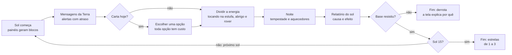
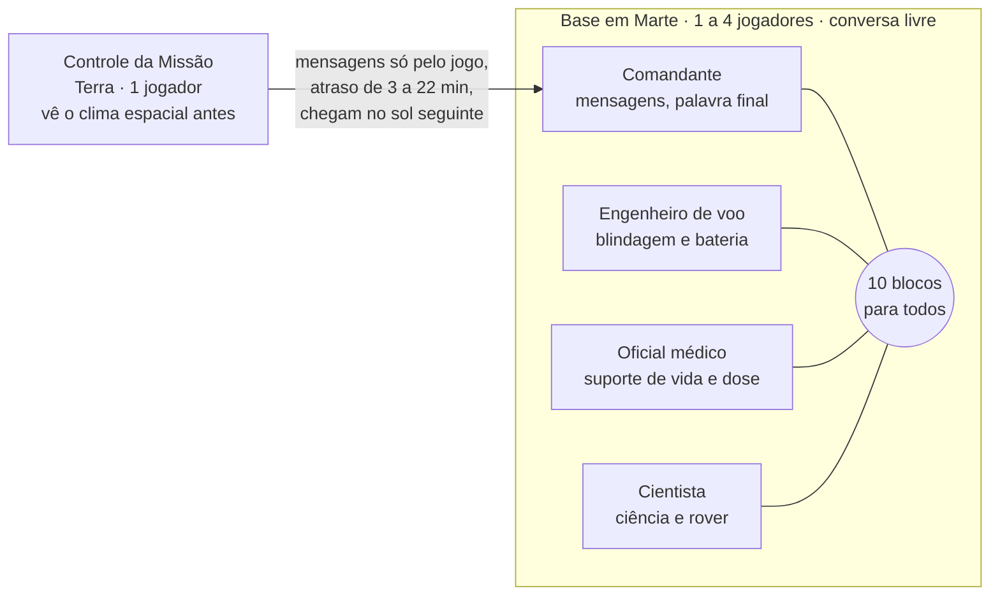
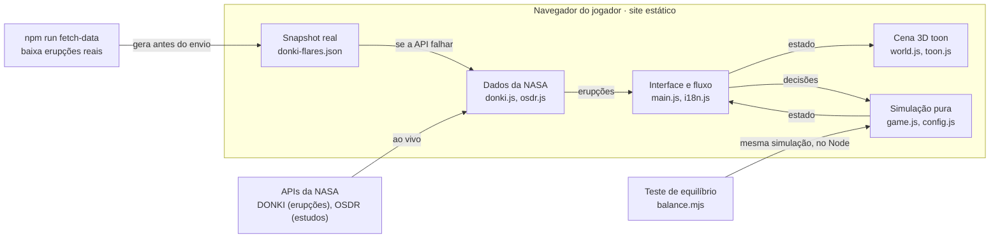

# Mars Exploration: Missão Jezero: documento de design do jogo (GDD)

> Documento vivo. Origem: GDD do time ("Tab 1"), versão de 14/11/2026, que substitui o rascunho "Base Marte Pi" (ver o histórico do git).
> Requisitos do desafio: [desafio.md](desafio.md). Mudou uma regra do jogo? Atualize aqui no mesmo PR; todo número real precisa de fonte.
> Este guia define a **jogabilidade**. A **arte** é definida pela [Art Bible](art-bible.md).
> Mudança de jogabilidade entra primeiro aqui; mudança de arte entra primeiro na Art Bible (ver [Alinhamento com a Art Bible](#alinhamento-com-a-art-bible)).

## Visão geral

Mars Exploration: Missão Jezero é um jogo de navegador. Nele, uma criança de 7 a 12 anos comanda uma base em Marte por 15 sóis. Para vencer, ela precisa dividir uma energia limitada entre sobreviver e fazer ciência.

| Item | Definição |
| --- | --- |
| Desafio | [Build a Junior Astronaut Mission Trainer](https://www.spaceappschallenge.org/2026/challenges/junior-astronaut-mission-trainer/), NASA Space Apps Challenge 2026 (14 e 15 de novembro) |
| Público | Crianças de 7 a 12 anos; também serve para pais e sala de aula |
| Plataforma | Navegador, sem download e sem conta; computador e celular |
| Local da missão | Cratera Jezero, Marte |
| Duração de uma partida | 15 sóis, cerca de 10 a 15 minutos |
| Jogadores | 1 no modo solo; de 2 a 5 no modo cooperativo, no mesmo aparelho (planejado) ou **online, cada um no seu aparelho** (servidor Go e cliente prontos: [servidor-coop.md](servidor-coop.md)) |
| Idiomas | Português e inglês |
| Protótipo atual | [Missão Jezero, versão jogável](https://claude.ai/artifact/N2MTXT1A145mwDge8USXFC) |

**Frase do jogo:** "Cada bloco de energia que você guarda hoje é o que mantém sua tripulação viva esta noite."

O desafio pede um protótipo funcionando que mostre uma troca real de engenharia com clareza. A criança deve sair entendendo uma restrição verdadeira da sobrevivência no espaço, e não só ter jogado algo divertido.

## Objetivos de aprendizagem

Ao fim de uma partida, a criança deve conseguir explicar com as próprias palavras estas quatro trocas reais de uma missão:

1. **Energia é limitada e a noite cobra a conta.** Os painéis só geram energia de dia; o que não for guardado na bateria falta à noite.
2. **Proteção custa caro, mas a falta de proteção custa a missão.** Reforçar a blindagem tira energia da ciência, mas uma tempestade solar sem blindagem pode encerrar a missão.
3. **A Terra está longe.** Mensagens levam de 3 a 22 minutos entre a Terra e Marte, e às vezes a equipe precisa decidir sozinha.
4. **Jogar só no seguro também falha.** A missão existe para fazer ciência; sobreviver sem descobrir nada dá só 1 estrela.

Termos científicos que o jogo explica no contexto, nunca de antemão: sol (dia marciano), dose de radiação, blindagem, regolito, erupção solar.

## Loop de jogo

Todo sol tem uma única decisão obrigatória: dividir a energia. Cartas aparecem em alguns sóis, e o jogo só termina quando a base cai ou quando o sol 15 acaba.



## Sistemas e regras

São três recursos centrais (energia, suporte de vida e blindagem), seguindo o conselho do desafio de não passar de 2 ou 3. A dose de radiação é a consequência, e a ciência é o objetivo.

**Energia em blocos.** A cada sol, os painéis geram 10 blocos de energia (no mínimo 2 com muita poeira). O jogador distribui os blocos entre suporte de vida, blindagem e ciência; o que sobra vai para a bateria.

| Recurso | Começa em | Regra por sol | Limite |
| --- | --- | --- | --- |
| Bateria | 50 | +10 por bloco que sobra; a noite gasta 20 | Máximo 100. Se faltar energia à noite, o suporte de vida perde 0,6 por ponto que faltou |
| Suporte de vida (ar, água, comida) | 70 | Precisa de 3 blocos para ficar estável; cada bloco a mais ou a menos muda 6 | Em 0, a missão termina |
| Blindagem | 40 | Perde 4 por desgaste; ganha 8 por bloco | Máximo 100 |
| Dose de radiação | 0 | +1 por sol, mesmo sem tempestade | Em 100, a tripulação volta para a Terra |
| Ciência | 0 | +3 por bloco; metade disso no sol de tempestade | Meta: 100 |
| Poeira nos painéis | 0% | Cai 6 pontos percentuais por sol com vento | Máximo 80%; reduz os blocos gerados na mesma proporção |

**Tempestade solar.** Um evento solar real do DONKI dispara a tempestade e define a intensidade dela no jogo. Nas [missões históricas](#calendário-da-missão-janelas-históricas-reais) (o modo padrão), o evento é uma ejeção de massa coronal (CME), e a força vem do tipo de velocidade: S e C = fraca, O = média, R e ER = forte. Sem as missões, o evento é uma erupção sorteada, e a força vem da classe: C = fraca, M = média, X = forte. As duas usam a mesma escala: fraca (10), média (25), forte (45). A dose recebida é calculada assim:

```
dose = max(1, round(intensidade × (1 − blindagem / 100 × 0,85)))
```

Essa é uma escala do jogo, classificada como INTERPRETADO, e não a dose real na superfície de Marte. O jogo informa isso ao jogador.

Todos esses números são simplificados para o jogo e ficam em um único arquivo de configuração (`src/sim/config.ts`). O que é real é o evento solar (CME ou erupção), não a escala da dose ([Art Bible, seção 7.5](art-bible.md#75-donki)).

## Eventos e decisões

Cada partida sorteia 1 das 6 [missões históricas](#calendário-da-missão-janelas-históricas-reais), que traz 3 tempestades solares reais, além de 1 tempestade de poeira e 4 das 8 cartas de decisão. Assim, nenhuma partida é igual à outra, o que incentiva a criança a testar estratégias diferentes.

**Tempestade solar e atraso de comunicação.** O alerta chega pela antena um sol antes do impacto. Ele diz a força da tempestade, a data real do evento e quantos minutos a mensagem levou para chegar: na missão histórica, o atraso real daquele sol (JPL Horizons); sem ela, sorteado entre 3 e 22. No sol do impacto, um segundo aviso lembra que é a última chance de reforçar a blindagem. As tempestades acontecem entre o sol 4 e o sol 14, com pelo menos 2 sóis de distância entre elas.

### Calendário da missão: janelas históricas reais

> **Estado: implementado** (2026-11-14). Código: [`src/sim/historical.ts`](../src/sim/historical.ts) (leitura e sorteio), [`src/sim/mission.ts`](../src/sim/mission.ts) (tempestades e atraso), [`src/data/missions.ts`](../src/data/missions.ts) (carregamento). Dados: [`public/data/missions.json`](../public/data/missions.json).

Cada partida acontece numa janela real de 15 sóis do passado. O sol 1 é uma data de verdade, e tudo o que o jogo chama de real vem desses mesmos dias: as tempestades (DONKI), o atraso das mensagens e a posição do Sol (JPL Horizons). Na tela final, o jogo conta: "Sua missão foi de 6 a 21 de maio de 2024. As tempestades aconteceram de verdade."

**Força das tempestades.** As missões usam ejeções de massa coronal (CME) do DONKI, pelo tipo de velocidade: S e C = fraca (10), O = média (25), R e ER = forte (45). Foram escolhidas porque o endpoint de CMEs responde direto, com tipo e velocidade. A escala é a mesma das erupções (`strengthClass` em `src/sim/config.ts`), então há uma só regra de força. Para crianças, o jogo chama a CME de "nuvem de plasma do Sol" e mostra a força (fraca, média ou forte) e a velocidade.

**Como o tempo corre.** Um sol dura 24 h 39 min 35 s ([NASA](https://science.nasa.gov/mars/facts/)). O sol *k* da partida começa em `data inicial + (k − 1) × 1,0275 dia`. Uma tempestade cai no sol que contém o horário de início da CME.

**Como as janelas foram escolhidas** (DONKI, CMEs de 2023-01-01 a 2026-11-14, baixadas em 2026-11-14):

- pelo menos 3 CMEs do tipo O, R ou ER entre os sóis 4 e 14, com pelo menos 2 sóis de distância entre elas (a mesma regra das tempestades);
- quando um sol tem mais de uma CME, vale a mais forte (tipo e, no empate, velocidade);
- das combinações possíveis, fica a de maior soma de força;
- janelas com pelo menos 45 dias de distância, para não repetir os mesmos eventos.

| Missão | Sol 1 | Tempestades (sol: tipo, velocidade, data UTC) | Força | Atraso Terra-Marte |
| --- | --- | --- | --- | --- |
| 1 | 2023-02-27 | 6: O, 1.576 km/s, 04/03 · 9: O, 1.182 km/s, 07/03 · 14: R, 2.127 km/s, 13/03 | Média | 9 a 11 min |
| 2 | 2023-07-25 | 4: R, 2.000 km/s, 28/07 · 8: O, 1.369 km/s, 01/08 · 11: O, 1.044 km/s, 05/08 | Média | 20 min |
| 3 | 2024-01-31 | 10: R, 2.534 km/s, 09/02 · 12: ER, 3.529 km/s, 12/02 · 14: R, 2.012 km/s, 14/02 | Difícil | 19 min |
| 4 | 2024-05-06 | 4: O, 1.330 km/s, 09/05 · 9: R, 2.119 km/s, 14/05 · 14: R, 2.678 km/s, 20/05 | Difícil | 16 min |
| 5 | 2025-03-15 | 4: O, 1.188 km/s, 19/03 · 7: ER, 3.032 km/s, 21/03 · 14: R, 2.212 km/s, 28/03 | Difícil | 8 a 9 min |
| 6 | 2025-10-18 | 4: R, 2.077 km/s, 21/10 · 6: O, 1.133 km/s, 23/10 · 9: O, 1.312 km/s, 26/10 | Média | 20 min |

"Força" é a soma das intensidades do jogo (média = 95; difícil = 115 ou 135). Os identificadores e links de cada CME (por exemplo, `2024-05-20T05:36:00-CME-001`, [DONKI](https://ccmc.gsfc.nasa.gov/DONKI/view/CME/31034/-1)) ficam em [`public/data/missions.json`](../public/data/missions.json), gerado por `npm run data:missions` ([scripts/fetch-missions.mjs](../scripts/fetch-missions.mjs)). O atraso é a distância Terra-Marte do JPL Horizons no início e no fim da janela, dividida pela velocidade da luz.

A missão 4 é a melhor para contar a história: a CME do sol 14 (20 de maio de 2024) veio com uma erupção estimada em X12, e a tempestade atingiu Marte com tanta energia que apareceu nas câmeras do Curiosity ([NASA](https://www.nasa.gov/solar-system/planets/mars/nasa-watches-mars-light-up-during-epic-solar-storm/)).

**Regras:**

- Na primeira partida, o jogo sorteia entre as missões de força média; as difíceis entram a partir da segunda.
- O alerta continua chegando um sol antes do impacto, agora com a data real do evento.
- A dose continua sendo a escala do jogo (INTERPRETADO). O que é real é a data, o tipo e a velocidade da CME, nunca a dose.
- As janelas são dados baixados. O selo é "dados reais baixados em 2026-11-14", nunca "ao vivo".
- Na tela inicial do sol 1, um aviso diz a missão e a data real em que ela começa.
- Todas as mensagens da Terra usam o atraso real do sol em que chegam.
- Na tela final, o jogo mostra as datas da missão, as 3 tempestades com data, força e link para o DONKI, e o atraso real mínimo e máximo das mensagens.
- A tela "Dados da NASA" mostra o DONKI e o JPL Horizons com o selo "dados reais baixados".
- Sem o arquivo das missões, o jogo volta às erupções reais sorteadas (`donki-flares.json`) e, sem elas, às simuladas.
- "Primeira partida" é guardada no navegador (`localStorage`). Sem ele, toda partida conta como a primeira.

**Equilíbrio** (`npm run balance`, 2.000 partidas por estratégia e por missão, 2026-11-14). A forma se mantém em todas: as duas estratégias extremas falham e a atenta sempre sobrevive.

| Estratégia | M1 | M2 | M3 | M4 | M5 | M6 |
| --- | --- | --- | --- | --- | --- | --- |
| Só ciência | Perde sempre | Perde sempre | Perde sempre | Perde sempre | Perde sempre | Perde sempre |
| Só segurança | 1 estrela | 1 estrela | 1 estrela | 1 estrela | 1 estrela | 1 estrela |
| Ignora a blindagem | Perde 100% | Perde 67% | Perde 100% | Perde 100% | Perde 100% | Perde 68% |
| Atenta: 3 estrelas | 73% | 77% | **8%** (64% com 2) | 64% | 65% | 85% |

A missão 3 tem as três tempestades fortes nos sóis 10, 12 e 14: a estratégia atenta sobrevive, mas quase sempre termina com dose acima de 50. Ela é a mais difícil de propósito e só aparece a partir da segunda partida. Se ficar difícil demais nos testes com crianças, troque-a por outra janela com a mesma regra de escolha.

**Tempestade de poeira.** Soma 40 pontos percentuais de poeira nos painéis. A poeira fica assim por 3 sóis antes de o vento começar a limpar.

**Cartas de decisão.** Toda opção tem um custo, direto ou de oportunidade. Nenhuma escolha sai de graça. Uma carta aparece no começo do sol e precisa ser respondida antes de o jogador planejar a energia.

| Carta | Opção A | Opção B | Opção C | O que ensina |
| --- | --- | --- | --- | --- |
| Painéis empoeirados (a carta já soma 25% de poeira) | Astronauta limpa: poeira −30%, dose +4 | Esperar o vento: nada muda agora | — | Sair da base expõe à radiação |
| Rocha misteriosa | Mandar o rover: ciência +15, bateria −20 | Deixar para lá | — | Ciência gasta energia |
| Vazamento na estufa | Consertar agora: bateria −15, ciência −5 | Consertar depois: vida −15 | — | Adiar um reparo cobra mais caro |
| Nave de carga | Baterias: bateria +30 | Kit de blindagem: blindagem +30 | Experimento: ciência +15 | Espaço de carga é limitado |
| Sensor quebrado | Pedir ajuda à Terra: ciência −10 | Consertar sozinhos: 50% de chance de dar errado (bateria −20) | — | Atraso de comunicação força decisões autônomas |
| Gelo no subsolo | Perfurar: bateria −20, vida +20 | Agora não | — | Recursos locais custam energia para extrair |
| Fazer oxigênio (MOXIE) | Ligar o MOXIE: bateria −15, vida +10 | Guardar a energia | — | Fazer oxigênio em Marte é possível, mas gasta energia |
| Caminho do rover | Caminho seguro: ciência +5 | Atalho: ciência +15, mas 50% de chance de o rover atolar hoje (vira o problema "Rover atolado"; sem resgate até a noite, a ciência do dia se perde) | — | Rapidez contra risco; o rover real escolhe o caminho para fugir de areia |

Os números das duas últimas cartas ficam em `CONFIG.rover` (`src/sim/config.ts`). Se o rover já ia atolar no mesmo dia, o atalho não cria um segundo problema.

### Fatos reais dos rovers

Cada fato aparece **uma vez por missão**, ligado ao que a criança acabou de viver. O fato é REAL; o efeito no jogo (números das cartas, chance de atolar) é INTERPRETADO.

| Onde aparece | Fato | Fonte |
| --- | --- | --- |
| Lição da carta "Fazer oxigênio" | O MOXIE do Perseverance fez 122 g de oxigênio em Marte (até 12 g por hora) | [NASA, 2023](https://www.nasa.gov/missions/mars-2020-perseverance/perseverance-rover/nasas-oxygen-generating-experiment-moxie-completes-mars-mission/) |
| Lição da carta "Caminho do rover" | O Perseverance dirige sozinho (AutoNav) em mais de 90% do caminho, desviando de perigos | [NASA](https://science.nasa.gov/missions/mars-2020-perseverance/driving-farther-and-faster-with-autonomous-navigation-and-helicopter-scouting) |
| Relatório do sol 1 | O Perseverance também usa baterias para os picos de consumo (gera cerca de 110 W) | [JPL, press kit](https://www.jpl.nasa.gov/news/press_kits/mars_2020/landing/mission/spacecraft/power/) |
| Relatório do sol da tempestade de poeira | Em 2018, uma tempestade de poeira global cortou a energia do Opportunity; a missão terminou em 2019 | [NASA](https://www.nasa.gov/news-release/nasas-record-setting-opportunity-rover-mission-on-mars-comes-to-end/) |
| Relatório do sol em que o rover atolou | Em 2009, o Spirit atolou em areia fofa; a NASA encerrou a missão em 2011 | [JPL](https://www.jpl.nasa.gov/missions/mars-exploration-rover-spirit-mer-spirit/) |
| Tela "Dados da NASA" | O RAD do Curiosity mediu cerca de 0,67 mSv por dia na superfície de Marte (cratera Gale, 2012–2013). É a única medição de radiação **em Marte** no jogo; nunca é convertida na dose do jogo | [NASA](https://www.nasa.gov/news-release/nasa-rover-results-include-first-age-measurement-on-mars-and-help-for-human-exploration/) |

## Vitória, derrota e estrelas

A missão termina bem quando a base chega viva ao fim do sol 15. A nota de 1 a 3 estrelas mede o quão bem a missão foi cumprida.

| Resultado | Condição |
| --- | --- |
| Derrota: sem ar e água | Suporte de vida chega a 0 |
| Derrota: radiação demais | Dose chega a 100 |
| 1 estrela | Sobreviveu os 15 sóis |
| 2 estrelas | Sobreviveu e fez pelo menos 100 de ciência |
| 3 estrelas | Sobreviveu, fez 100 de ciência e terminou com dose abaixo de 50 |

A derrota não pode parecer castigo. A tela final explica o que aconteceu, lista o que astronautas de verdade também enfrentam e oferece jogar de novo com eventos novos.

**Equilíbrio esperado.** Testado com 2.000 partidas simuladas por estratégia (`npm run balance`):

| Estratégia | Protótipo original | Este repositório, erupções reais (M5+ e X) | Este repositório, erupções simuladas (C, M, X) |
| --- | --- | --- | --- |
| Só ciência, sem guardar bateria | Perde sempre | Perde sempre (suporte de vida) | Perde sempre |
| Só segurança, sem ciência | Sempre sobrevive, 1 estrela | Sempre sobrevive, 1 estrela | Sempre sobrevive, 1 estrela |
| Ignora a blindagem | Perde 31% por radiação | **Perde 73% por radiação** | Perde 35% por radiação |
| Reage aos alertas e guarda reserva | Sobrevive, 80% com 3 estrelas | Sobrevive sempre, ~69% com 3 estrelas | Sobrevive sempre, ~73% com 3 estrelas |

Medição de 2026-11-14 (`npm run balance`, 2.000 partidas por estratégia). Com erupções reais o jogo fica
mais difícil, porque o DONKI só registra erupções a partir de M5.0 (não há classe C, a "fraca"). A forma se mantém.

Qualquer mudança nos números deve manter essa forma: as duas estratégias extremas falham e a estratégia atenta vence.

**Com as cartas do rover** (MOXIE e "Caminho do rover", 2026-11-14, 1.000 partidas por estratégia, erupções reais, simuladas e as 6 missões): a forma se mantém em todos os cenários. As estratégias extremas continuam falhando sempre, "ignora a blindagem" não mudou, e a estratégia atenta (que pega o atalho e resgata o rover) termina com 1 estrela um pouco menos vezes (ex.: erupções reais, de 9% para 5%).

## Modo cooperativo

O jogo aceita de 1 a 5 jogadores no mesmo aparelho, com duas camadas de cooperação:

- a Terra coopera com Marte só por mensagens com atraso;
- os papéis em Marte cooperam dividindo a mesma energia.

As duas camadas vêm de como a NASA treina tripulações para Marte.



A Terra sabe do clima espacial antes, mas não decide. Marte decide, mas recebe os avisos atrasados. Um precisa do outro.

| Camada | Quem coopera | Como se comunicam | O que ensina |
| --- | --- | --- | --- |
| Terra ↔ Marte | Controle da Missão e tripulação | Só por mensagens dentro do jogo, com atraso | Comunicação lenta; a tripulação às vezes decide sozinha |
| Dentro de Marte | Comandante, engenheiro de voo, oficial médico e cientista | Conversando livremente, porque estão juntos na base | Um orçamento só para todos: cada papel puxa para o seu lado e o grupo negocia |

### Modos por número de jogadores

| Jogadores | Terra | Marte |
| --- | --- | --- |
| 1 | Automática (como hoje) | Um jogador controla tudo |
| 2 | 1 jogador | 1 jogador controla os quatro papéis |
| 3 a 5 | 1 jogador | 2 a 4 jogadores dividem os papéis; com menos de 4, alguém acumula papéis |

### Papéis em Marte

| Papel | Cuida de | Quer |
| --- | --- | --- |
| Comandante | Mensagens da Terra, cartas e o botão "Terminar o sol" | Cumprir a missão sem perder ninguém |
| Engenheiro de voo | Blocos de blindagem; defende deixar sobra para a bateria | Abrigo forte e bateria cheia para a noite |
| Oficial médico | Blocos de suporte de vida; acompanha a dose | Vida alta e dose baixa |
| Cientista | Blocos de ciência e o rover | Chegar à meta de 100 de ciência |

Os quatro papéis são os mesmos das tripulações da CHAPEA, em que o engenheiro de voo mantém os sistemas do habitat funcionando. A divisão de quem cuida de qual recurso é uma escolha nossa para o jogo: cada papel tem uma faixa de blocos, e a bateria recebe o que sobrar.

### Regras

- Os 10 blocos do sol são um orçamento só. Cada papel só mexe nos blocos do seu sistema; se alguém quer mais, outro precisa ceder.
- O comandante tem a palavra final: decide as cartas quando o grupo não chega a um acordo, e encerra o sol.
- A Terra não fala em voz alta com Marte, só pelas mensagens do jogo. Na sala de aula, o Controle da Missão fica de costas ou em outra mesa.
- A Terra envia no máximo 1 mensagem por sol, escolhida de uma lista curta: "Tempestade solar chegando: reforcem a blindagem", "Poeira a caminho: guardem bateria", "Boa janela para ciência", "Cuidem do suporte de vida" e "Sem novidades".
- A mensagem chega no sol seguinte e mostra quantos minutos levou.
- A Terra enxerga o clima espacial de hoje até **2 sóis à frente**: assim a mensagem enviada hoje chega amanhã, ainda um sol antes da tempestade.
- Com jogador na Terra, o aviso **antecipado** só vem dela. No dia da tempestade ou da poeira, o **alarme da base** dispara sozinho, para a criança de Marte nunca ficar sem nenhum aviso. Sem jogador na Terra, os avisos são automáticos, como no solo.

### Como fica um sol no cooperativo

1. **Vez da Terra:** vê o clima espacial e o relatório do sol anterior, e escolhe uma mensagem.
2. **Vez de Marte:** lê as mensagens que chegaram; o grupo decide a carta, se houver; cada papel ajusta os seus blocos no seu lugar da base; o comandante termina o sol.
3. **Relatório para todos:** mostra o resultado e a decisão de cada papel, para o grupo conversar sobre a estratégia.

### Base na NASA

- A CHAPEA, simulação de Marte da NASA em Houston, usa tripulações de quatro pessoas: comandante, engenheiro de voo, oficial médico e oficial de ciência ([Missão 1](https://www.nasa.gov/missions/analog-field-testing/chapea/first-mars-crew-completes-yearlong-simulated-red-planet-nasa-mission/), [Missão 2](https://www.nasa.gov/centers-and-facilities/johnson/chapea-mission-2-crew-reflects-after-378-days-on-simulated-mars/)).
- A tripulação da CHAPEA convive com atraso de comunicação de até 22 minutos em cada sentido e com o apoio de equipes em solo ([NASA](https://www.nasa.gov/?p=536668)). A oficial médica da Missão 2 disse que uma tripulação em Marte precisa de uma equipe em solo muito integrada.
- Nos planos de missão real, a análise mais recente da NASA prevê quatro tripulantes indo a Marte, dois deles descendo à superfície por 30 sóis ([NASA NTRS](https://ntrs.nasa.gov/api/citations/20230012629/downloads/Overview%20of%20Crew%20Operations%20for%20Transit%20to%20Mars%20V5.pdf)). A base do jogo, com estufa e vários módulos, se parece mais com a CHAPEA do que com essa primeira missão curta.

### Escopo

| Parte | Quando | Esforço estimado |
| --- | --- | --- |
| Quatro astronautas com papéis na cena e no relatório | Hackathon | 2 a 3 h |
| Terra e Marte com 2 jogadores, mesmo aparelho | Hackathon | 4 a 6 h |
| Tempo da tripulação e movimentação (seção seguinte) | Hackathon | 6 a 8 h |
| Sala de aula, de 3 a 5 jogadores com papéis | Evolução | 4 h ou mais |
| Online, cada jogador no seu aparelho | **Pronto** ([servidor-coop.md](servidor-coop.md), [ADR 0005](decisoes/0005-servidor-coop-em-go-com-as-regras.md)): sala com código, papéis, vez da Terra, energia dividida por papel | Feito |

### Pronto quando

- [ ] A cena mostra quatro astronautas, um por papel, e o relatório diz qual papel decidiu o quê.
- [ ] No modo de 2 jogadores, a mensagem da Terra só aparece em Marte no sol seguinte, com o atraso em minutos.
- [ ] A Terra vê o clima espacial antes de Marte.
- [ ] Sem segundo jogador, o modo solo continua igual ao de hoje.

## Tempo da tripulação e movimentação

Além da energia, o jogo ensina um segundo recurso real: o tempo da tripulação. Cada astronauta só está num lugar por vez, anda até o problema e leva tempo para consertar; se ele está ocupado, outro precisa ir. Os objetivos da NASA de Lua a Marte tratam o tempo da tripulação para ciência e engenharia como algo a maximizar ([NASA NTRS](https://ntrs.nasa.gov/api/citations/20230012629/downloads/Overview%20of%20Crew%20Operations%20for%20Transit%20to%20Mars%20V5.pdf)).

Este modo e o modo Terra e Marte funcionam juntos: os dois fazem parte do jogo.

**Controle, sem joystick.** A criança aperta o botão do problema (ou toca no "!"). Para um problema de fora, sai uma dupla em EVA, que anda até lá, trabalha e volta sozinha (ver [EVA: sair da base](#eva-sair-da-base)). No modo solo, um jogador comanda os quatro. No cooperativo, cada jogador de Marte é dono do astronauta do seu papel; com menos de 4 jogadores em Marte, alguém comanda mais de um.

**Dois jeitos de controlar, ao mesmo tempo** (decisão de 14/11/2026, sem menu de configuração):

| Ação | Clique / toque | Teclado |
| --- | --- | --- |
| Escolher astronauta | Botões da tripulação na lista do dia (🏠 dentro, 🚪 na câmara, 👩‍🚀 lá fora) ou tocar nele quando está lá fora | Teclas **1 a 4** (comandante, engenheiro de voo, oficial médico, cientista) |
| Ver quem é (mouse) | Passar o mouse: destaque, cursor de mãozinha e o nome do papel; sobre um “!”, o problema e quem será enviado | — |
| Achar problema fora da tela | Uma seta na borda aponta para cada problema fora do enquadramento, com o nome; tocar nela envia o astronauta selecionado | Tab até a seta e Enter |
| Andar | Tocar no chão; ele anda sozinho até lá | **Setas** ou **WASD**, relativas à câmera |
| Pular | — | **Espaço** (mostra que a gravidade de Marte é 38% da Terra) |
| Dividir a energia | Tocar no **+ / −** sobre a estufa, o abrigo ou o rover | **Tab** e **Enter** |
| Janelas e botão do dia | Botões | **Tab** e **Enter** |

A movimentação usa física (Rapier) com a gravidade de Marte, carregada em segundo plano; enquanto ela carrega, ou se falhar, o jogo continua só com a interface.

### Como fica um sol com as duas opções

1. **Vez da Terra** (só no cooperativo com Terra): vê o clima espacial e envia uma mensagem.
2. **Manhã, por turno:** o plano de energia, tocando nos lugares da base. A tripulação continua dentro da base.
3. **Dia, em tempo real** (60 a 90 segundos, com pausa): problemas aparecem pela base e a tripulação decide quem vai aonde.
4. **Noite:** tempestade e aquecedores. O relatório mostra a energia e o que foi ou não consertado.

### Problemas pela base

Tempos e efeitos são valores iniciais de jogo, ainda a balancear.

| Problema | Onde | Tempo da tarefa | Se ninguém for até a noite |
| --- | --- | --- | --- |
| Poeira nos painéis | Fora da base | 15 s | Amanhã os painéis geram menos blocos |
| Vazamento na estufa | Dentro | 10 s | Suporte de vida −10 |
| Antena desalinhada | Fora, no alto da torre | 15 s | A mensagem da Terra não chega no sol seguinte |
| Rover atolado | Longe da base | 20 s, mais a caminhada longa | Ciência do dia perdida |
| Saco de regolito rasgado | Fora, no abrigo | 10 s | Blindagem −8 |

### Regras

- Um lugar por vez. Mandar um astronauta ocupado para outro problema faz ele largar o que estava fazendo e perder o progresso.
- Distância custa tempo: atravessar a base inteira leva cerca de 10 segundos.
- Trabalho fora da base é uma EVA em dupla e passa pela câmara de descompressão (3 segundos para sair e 3 para voltar). Cada tarefa fora soma +1 de dose, na escala do jogo (INTERPRETADO). Dentro, não soma.
- No sol em que a tempestade chega, com o aviso da Terra recebido, ninguém sai (EVA proibida). Os problemas de fora daquele sol ficam para o dia seguinte, sem castigo. Esta regra substitui a antiga "durante um alerta, o comandante fica na antena".
- Na noite de tempestade, quem estiver fora corre para o abrigo; o que ficou pela metade continua no dia seguinte.
- Aparecem só 1 ou 2 problemas por dia, a partir do sol 3, para não sobrecarregar crianças de 7 a 12 anos. Eles substituem as cartas "Painéis empoeirados" e "Vazamento na estufa"; as outras cartas continuam.
- O dia sempre pode ser pausado, e pode correr mais devagar para crianças menores.

**Ligação com o modo Terra e Marte.** A Terra não controla astronautas, mas pode avisar antes ("poeira a caminho dos painéis"). Se a antena ficar desalinhada, a mensagem da Terra não chega. Assim, consertar a antena passa a importar para os dois lados.

**Implementado (14/11/2026):** dia de 75 s com pausa (P) e botão "Terminar o dia"; consertar clicando no "!", pelo botão do problema na lista ("Sair em EVA" ou "Consertar de dentro") ou chegando perto e apertando **E** (dentro, **E** pega o problema de dentro); EVA em dupla (seção abaixo); a tripulação contorna os prédios (busca de caminho). Decisões além do GDD: terminar o dia cedo conta os problemas que ainda não apareceram como não resolvidos; poeira não limpa = +20% de poeira; a câmara de descompressão soma 3 s às tarefas de fora. Ainda não: velocidade mais lenta para crianças menores. Equilíbrio medido (`npm run balance`, atenta resolvendo tudo): nunca perde; 3★ em ~19% (erupções reais) e ~43% (simuladas), contra ~69% antes dos problemas, por causa da dose +1 por tarefa fora. **Ajuste a decidir pelo time.**

**O que ensina:** tempo e lugar também são recursos limitados, a equipe precisa dividir tarefas, e sair da base tem um custo.

### EVA: sair da base

Decisão de 14/11/2026. A tripulação passa quase todo o tempo **dentro** da base e sai só em saídas curtas e planejadas, as EVAs (atividade extraveicular, sair com traje espacial).

**O dado real.** Nenhuma das APIs que o jogo usa (DONKI, Horizons, OSDR, RadLab, Mars Trek) traz tempo dentro e fora do habitat; o número vem de um relatório da NASA. Os trajes e equipamentos de EVA para a superfície estão sendo projetados para **até 24 horas de EVA por pessoa por semana**, em saídas de 6 a 8 horas, 3 a 4 vezes por semana ([NASA, *EVA Injury Evidence Report*, 2021, NTRS 20220004017](https://ntrs.nasa.gov/citations/20220004017)). Como a semana tem 168 horas, isso dá no máximo cerca de 14% do tempo fora, ou seja, **pelo menos 86% dentro**. A conta é nossa; o número de 24 horas é da NASA. O texto de origem da ideia ("80% a 90% dentro") não tinha fonte; a conta acima confirma a ordem de grandeza. A primeira missão de referência da NASA a Marte prevê dois tripulantes na superfície, com um rover pressurizado ([NASA, *Mars Surface Activities*, 2022, NTRS 20220000589](https://ntrs.nasa.gov/citations/20220000589)).

**Regras no jogo** (números em `CONFIG.eva` e `CONFIG.problems`, classificação INTERPRETADO):

| Regra | Como funciona | De onde vem |
| --- | --- | --- |
| Dentro por padrão | De manhã e de noite, todos ficam dentro. A cena só mostra astronautas lá fora durante uma EVA. O topo mostra "Dentro: 4 · Fora: 0" | Relatório da NASA acima (≥ 86% dentro) |
| Problema de dentro | Vazamento na estufa: alguém de dentro conserta sem sair (2 s de corredor e o tempo da tarefa). Não soma dose | Escolha de jogo |
| Problema de fora exige EVA | O botão é "Sair em EVA". Sai o astronauta escolhido (se estiver livre e dentro) e um parceiro livre | Escolha de jogo: em dupla, um ajuda o outro |
| Câmara de descompressão | 3 s para sair e 3 s para voltar, com o astronauta escondido | Valor de jogo |
| No máximo 2 fora | Só uma dupla por vez. Outro astronauta não sai enquanto ela trabalha ("Já tem uma dupla lá fora") | Escolha de jogo |
| A dupla anda junta | Um trabalha, o outro fica a cerca de 2 m. Um trabalho por dupla | Escolha de jogo |
| EVA curta | Terminou o conserto, a dupla volta sozinha. Parada lá fora sem tarefa, volta depois de 12 s. Há o botão "Voltar para dentro". Ainda com a dupla fora, dá para mandá-la a outro problema de fora sem passar de novo pela câmara | Escolha de jogo, para ensinar que se fica pouco tempo fora |
| Sem EVA no dia da tempestade | Com a mensagem "a tempestade chega hoje", o botão vira "Sem EVA hoje". O conserto de fora fica para amanhã (relatório: "ninguém saiu por causa da tempestade"). Sem o aviso (antena desalinhada), a tripulação não sabe e pode sair | Escolha de jogo, ligada ao aviso real do DONKI. Não achamos documento primário da NASA com a regra exata; por isso fica como INTERPRETADO |

**Fato na tela.** Na primeira EVA da partida aparece: "A NASA planeja até 24 horas de EVA por semana para cada astronauta. A semana tem 168 horas: quase todo o tempo é dentro." (fonte citada no aviso). O termo EVA tem "?".

**Equilíbrio** (`npm run balance`, estratégia atenta resolvendo tudo o que pode): praticamente igual ao de antes. 3★ em ~21% (erupções reais, antes ~19%) e ~45% (simuladas, antes ~43%); nas missões históricas, varia de 0 a +3 pontos. Sobe um pouco porque, no dia da tempestade, ninguém sai e a dose de tarefa fora não soma.

**Próxima entrega (ainda não feita):** dose por tempo fora em vez de +1 por tarefa, e um relógio de oxigênio do traje. Depois, rover pressurizado para o problema distante (mais rápido e sem dose, mas gasta bateria).

### Ordem de construção no hackathon

| Ordem | Parte | Esforço estimado | Por que nessa ordem |
| --- | --- | --- | --- |
| 1 | Quatro astronautas com papéis | 2 a 3 h | Base das duas opções |
| 2 | Terra e Marte com 2 jogadores | 4 a 6 h | O atraso de comunicação está nos objetivos do desafio |
| 3 | Tempo da tripulação e movimentação | 6 a 8 h | Mais realismo; usa os astronautas da etapa 1 |

As três partes somam de 12 a 17 horas, o que aperta o prazo de dois dias. Se o tempo faltar, a etapa 3 entra com 3 problemas em vez de 5.

### Pronto quando

- [x] Apertar o botão do problema (ou tocar no "!") manda alguém de dentro ou uma dupla em EVA, que anda até lá e conserta.
- [x] No máximo 2 fora; sem EVA no dia da tempestade.
- [ ] Um astronauta ocupado só vai para outro problema largando o atual.
- [ ] Problema sem atendimento aparece no relatório com a consequência.
- [ ] Trabalho fora da base soma dose; dentro, não.
- [ ] O dia pode ser pausado a qualquer momento.

## Atividades dentro da base (especificação)

> **Status:** especificação para implementar (decisão do time em 14/11/2026). Ainda não está no jogo.
> **Para quem implementa:** cada parte tem regras, textos, passo a passo por arquivo e "pronto quando". Faça na ordem A → C → B.
> **Pilar:** [público de 7 a 12 anos](publico-e-impacto.md). Nada aqui cria barra nova nem saúde por astronauta.

Uma base real tem mais que consertos: a tripulação **cultiva plantas, faz ciência, se exercita e descansa** ([F11](ciencia-marte.md#f11-a-rotina-de-uma-tripulação-em-marte)).
O jogo passa a mostrar isso de dois jeitos: **duas tarefas com efeito** (estufa e laboratório) e **uma rotina só visual** (exercício e descanso).
Junto vem a **faixa da tripulação** no HUD, para a criança ver o que cada astronauta está fazendo.

| Parte | O quê | Muda regra? | Por quê |
| --- | --- | --- | --- |
| **A** | 🌱 Colher na estufa e 🔬 analisar amostras no laboratório, durante o dia em tempo real | **Sim, pequena** | Cria a troca mais educativa do dia: consertar lá fora (com dose) ou produzir aqui dentro (seguro)? |
| **B** | 💪 Exercício e 😴 descanso automáticos de quem está sem ordem | Não (só cena) | Base viva e realista, com fato educativo ([F9](ciencia-marte.md#f9-astronautas-se-exercitam-todo-dia)), sem carga para a criança |
| **C** | Faixa com os 4 astronautas e o que cada um está fazendo | Não (só HUD) | No modo em grupo, cada criança vê o que os colegas fazem |
| ~~D~~ | ~~Saúde, cansaço e humor por astronauta~~ | — | **Descartado:** barras novas e microgestão, pesado para 7 a 9 anos |

### A. Tarefas dentro da base: estufa e laboratório

| Tarefa | Onde | Tempo | Efeito ao terminar | Limite | Dose |
| --- | --- | --- | --- | --- | --- |
| 🌱 **Colher na estufa** | Dentro da cúpula da estufa | 15 s | Suporte de vida **+3** | 1 vez por dia | Nenhuma (dentro) |
| 🔬 **Analisar amostras** | Laboratório, no módulo do habitat | 20 s | Ciência **+4** | 1 vez por dia | Nenhuma (dentro) |

Valores **iniciais, a balancear** (ver [Balanceamento](#balanceamento-das-tarefas)).

**Regras:**

1. Só existem nos **dias em tempo real** (a partir do sol 3), e estão disponíveis **desde o começo do dia**. Nos sóis 1 e 2 a criança aprende só a energia ([aprende jogando](publico-e-impacto.md#interface-e-controle)).
2. São **opcionais**: não fazer não tem consequência, só perde o bônus. É a diferença para os problemas, que cobram a conta à noite.
3. Mandar um astronauta é **igual aos problemas**: tocar no astronauta e na estação (ícone 🌱 ou 🔬 em vez de "!"), o botão "Enviar" na lista do dia, ou chegar perto e apertar **E**.
4. **Dentro da base**: não passam pela câmara de descompressão e **não somam dose**. É o contraste de propósito com os consertos lá fora.
5. Largar no meio (outra ordem, sair do lugar) **perde o progresso**, como nos problemas. Tarefa interna pela metade **não** continua no dia seguinte, mesmo em noite de tempestade (mais simples).
6. O dia continua terminando sozinho quando **tudo** (problemas e tarefas) está feito, ou aos 75 s. O comandante pode terminar antes, como hoje.
7. Relatório do sol: "Colheita na estufa: suporte de vida +3." / "Análise no laboratório: ciência +4."

**Textos (PT / EN):**

| Chave | PT | EN |
| --- | --- | --- |
| `problem.harvest` | Colher na estufa | Harvest the greenhouse |
| `problem.harvest.where` | Cúpula da estufa | Greenhouse dome |
| `problem.analysis` | Analisar amostras | Analyze samples |
| `problem.analysis.where` | Laboratório | Laboratory |
| `day.optional` | Se sobrar tempo: | If there is time left: |
| `report.task.harvest` | Colheita na estufa: suporte de vida +{life}. | Greenhouse harvest: life support +{life}. |
| `report.task.analysis` | Análise no laboratório: ciência +{science}. | Lab analysis: science +{science}. |

**Como implementar** (reaproveita todo o sistema de problemas; o modo em grupo funciona sem mudar o protocolo):

| # | Arquivo | O que fazer |
| --- | --- | --- |
| 1 | `src/sim/config.ts` | `indoorTasks: { harvest: { seconds: 15, life: 3 }, analysis: { seconds: 20, science: 4 } }` |
| 2 | `src/sim/types.ts` | `ProblemKind` ganha `'harvest' \| 'analysis'` |
| 3 | `src/sim/problems.ts` | Acrescentar os dois em `PROBLEMS` com `outside: false` e um campo novo `optional: true` (os outros, `optional: false`). **Cuidado:** `PROBLEM_KINDS` é usado no sorteio dos problemas do dia; ele precisa **excluir** os opcionais (`.filter((k) => !PROBLEMS[k].optional)`), senão o sorteio passa a escolher "colher na estufa" como problema e todas as partidas mudam |
| 4 | `src/sim/problems.ts` (`scheduleProblems`) | Depois de sortear e ordenar os problemas, **acrescentar** as duas tarefas com `spawnAt: 0`, **sem** usar o gerador aleatório (não muda o sorteio do resto) |
| 5 | `src/sim/mission.ts` (`resolveProblem`) | Se for opcional: aplicar o efeito (vida com `clamp` no máximo; ciência sem teto), linha `report.task.*`, **sem** dose |
| 6 | `src/sim/mission.ts` (`endSol`) | Opcionais não feitos ficam **fora** de `failed` e de `carried` (nada acontece) |
| 7 | `src/scene/MarsBase.ts` | `PROBLEM_SPOTS.harvest` (dentro da cúpula) e `PROBLEM_SPOTS.analysis` (no módulo do laboratório). O astronauta precisa conseguir chegar: confira com `crewPath` |
| 8 | `src/scene/ProblemMarkers.ts` | Ícone por tipo: 🌱 e 🔬 nos opcionais, "!" nos problemas |
| 9 | `src/ui/Hud.ts` (`renderDay`) | Opcionais numa subseção "Se sobrar tempo:", depois dos problemas |
| 10 | `src/i18n/strings.ts` | Chaves da tabela acima |
| 11 | `scripts/balance.ts` | A estratégia "atenta" faz as tarefas quando sobra astronauta livre |
| 12 | `npm run build` | Regera o `server/internal/sim/simjs/sim.js`: **o modo em grupo já funciona**, porque as tarefas usam `problem_progress`/`problem_resolve`. Não precisa mexer em Go |

**Pronto quando:**

- [ ] A partir do sol 3, a lista do dia mostra "Se sobrar tempo:" com 🌱 e 🔬.
- [ ] Mandar um astronauta à estufa: ele entra, trabalha 15 s e o suporte de vida sobe 3, sem dose.
- [ ] Cada estação só pode ser usada uma vez por dia.
- [ ] Não fazer as tarefas não muda nada à noite.
- [ ] O sorteio dos problemas continua igual (mesma semente = mesmos problemas que antes).
- [ ] Em grupo: o médico colhe na estufa e o comandante vê a tarefa ✅ e o efeito no relatório.

#### Balanceamento das tarefas

Hoje (ver "Implementado" em [Tempo da tripulação](#tempo-da-tripulação-e-movimentação)), com os problemas, a estratégia atenta chega a 3★ em só **~19%** das partidas com erupções reais (eram ~69% antes). As tarefas internas são uma alavanca natural para recuperar isso **sem** facilitar demais:

| Estratégia (`npm run balance`) | Meta depois das tarefas |
| --- | --- |
| Só ciência, sem guardar bateria | Continua perdendo sempre |
| Só segurança, sem ciência | Continua em 1★ (o laboratório sozinho não chega a 100 de ciência) |
| Ignora a blindagem | Continua perdendo parte das vezes por radiação |
| Atenta (resolve problemas e faz as tarefas) | **3★ em 40 a 60%** (nem tão difícil quanto hoje, nem garantido) |

Se a atenta passar de 60%, reduza o efeito (ex.: ciência +3). Se ficar abaixo de 40%, aumente o laboratório ou reveja a dose +1 por conserto lá fora.

### B. Rotina visual: exercício e descanso

**Regras (só cena, nenhuma regra muda):**

1. Astronauta **sem ordem há 8 s**, de dia ou de manhã, anda sozinho até a **esteira** (dentro do habitat) e faz uma animação de exercício.
2. Depois de um tempo (ex.: 20 s), vai ao **beliche** e "descansa" (fica dentro, como à noite), e depois volta ao posto.
3. Qualquer ordem do jogador (tocar, setas, tarefa) interrompe na hora.
4. Não acontece à noite (a tripulação já entra) nem com alerta de tempestade aberto.
5. Na **primeira** vez por partida que alguém se exercita: cartão "Você sabia?" com o fato [F9](ciencia-marte.md#f9-astronautas-se-exercitam-todo-dia).
6. **Modo em grupo:** só o **dono** do astronauta decide a rotina (piloto automático na tela dele); os outros veem pela posição sincronizada (`crew_pos`). Nunca rode a rotina para o astronauta de outro jogador.

**Como implementar:**

| Arquivo | O que fazer |
| --- | --- |
| `src/scene/MarsBase.ts` | Pontos `ROUTINE_SPOTS.treadmill` (dentro do habitat) e `ROUTINE_SPOTS.bunk` |
| `src/scene/crewMotion.ts` | Reaproveitar o piloto automático (`walkPath`/`auto`, o mesmo de ir dormir). Expor algo como `startRoutine(role, spot, onArrive)` e cancelar em `moveRole`/setas |
| `src/scene/Crew.ts` | Animação simples de exercício (balanço no lugar) e de descanso (escondido, como dentro) |
| `src/core/Game.ts` | Relógio de "sem ordem" por astronauta; só para `canControl(role)` no modo em grupo |
| `src/i18n/strings.ts` | `fact.exercise` (texto PT/EN do F9) |

**Pronto quando:**

- [ ] Astronauta parado 8 s vai para a esteira; uma ordem tira ele de lá na hora.
- [ ] O cartão do F9 aparece só uma vez por partida.
- [ ] Em grupo, o astronauta de outro jogador só se mexe pelo que o dono manda.

### C. Faixa da tripulação no HUD

Uma faixa com os 4 astronautas. Cada ícone tem **no máximo 3 informações**; o detalhe aparece **só no selecionado**.

```
 [👨‍🚀 Comandante ▸ você]  [🔧 Engenheiro 60%]  [🌱 Médico · J2]  [💪 Cientista]
  ─ selecionado: "Comandante · parado · toque num ⚠️ para consertar" ─
```

| Status | Quando |
| --- | --- |
| 🧍 parado · 🚶 andando · 🔧 consertando % | Problemas (hoje) |
| 🌱 colhendo % · 🔬 analisando % | Parte A |
| 💪 exercício · 😴 descansando | Parte B |
| 🏠 dentro | À noite ou no abrigo |
| Borda laranja 🌡️ **fora da base** | Fora da câmara: lembra que sair custa dose |
| ⚠️ piscando | **Alerta de tempestade e astronauta lá fora**: "volte para dentro" ([F7](ciencia-marte.md#f7-quem-está-fora-volta-para-dentro)). Único alerta da faixa |
| "J2" | Só no modo em grupo: quem controla (Jogador 2) |

**Regras para não poluir:** nada de barra de saúde individual; nenhum som ou janela a mais; no celular em pé, só ícones (o nome aparece no selecionado); tocar num ícone seleciona o astronauta (se for seu, no modo em grupo).

**Como implementar:** `src/ui/Hud.ts` (novo `renderCrew`, no lugar do chip atual); o status sai de `CrewTasks` (`workerOf`, `isWorking`), `crewMotion` (`targetOf`, `isInside`, posição) e da rotina da parte B. No modo em grupo, os astronautas dos outros usam a posição sincronizada. **Não precisa de servidor.**

**Pronto quando:**

- [ ] Os 4 ícones aparecem com o status certo, também no celular em pé.
- [ ] O ⚠️ pisca só com alerta de tempestade **e** astronauta fora.
- [ ] Em grupo, cada ícone mostra "J*n*" e tocar no de outro jogador mostra o aviso que já existe.

### Cartões "Você sabia?" desta parte

Uma vez por partida cada um ([regras dos fatos](ciencia-marte.md#regras-deste-documento)):

| Momento | Fato | Chave sugerida |
| --- | --- | --- |
| Primeira colheita na estufa | [F10](ciencia-marte.md#f10-a-estufa-dá-comida-fresca) | `fact.greenhouse` |
| Primeira vez que alguém se exercita | [F9](ciencia-marte.md#f9-astronautas-se-exercitam-todo-dia) | `fact.exercise` |
| Primeiro dia em tempo real (dica) | [F11](ciencia-marte.md#f11-a-rotina-de-uma-tripulação-em-marte) | `fact.routine` |

### Ordem e esforço

| Ordem | Parte | Esforço | Depende de |
| --- | --- | --- | --- |
| 1 | A (estufa e laboratório) + balanceamento | 4 a 6 h | — |
| 2 | C (faixa da tripulação) | 3 a 4 h | A (para os status 🌱 e 🔬) |
| 3 | B (rotina visual) | 2 h | C (para os status 💪 e 😴) |

## Energia no ambiente (especificação)

**Decisão (14/11/2026):** a energia é dividida **tocando nos lugares da base**, não no menu. O painel "Plano de energia" vira **só de visualização**: mostra os blocos, a prévia e os avisos, sem + e −.
As regras não mudam: 10 blocos por sol (menos com poeira), as mesmas faixas por papel, o que sobra vai para a bateria.

**Por quê:** a criança liga a energia ao lugar que ela alimenta. Ao reforçar o abrigo, ela vê a luz do rover apagar: é a troca do [objetivo 1](#objetivos-de-aprendizagem) acontecendo na cena.

### Onde cada bloco vai

| Parte do plano | Lugar na base | O que a cena mostra | Ícone |
| --- | --- | --- | --- |
| Suporte de vida | **Estufa** (cúpula) | Luzes das plantas acendem, uma faixa por bloco | 🌱 |
| Blindagem | **Abrigo** (sacos de regolito) | Escudo brilhante sobre o abrigo, mais forte com mais blocos | 🛡️ |
| Ciência | **Rover** | Faróis e painel do rover acendem | 🔬 |
| Bateria | **Bateria** (já existe o medidor) | Recebe o que sobra, **sem botão**: enche sozinha | 🔋 |

Dos **painéis solares** sai um **cabo** até cada lugar; o cabo acende com a quantidade de blocos. Sobra nenhuma: o cabo da bateria fica apagado.

### Como a criança joga

1. Na manhã (fase de plano), cada lugar da lista tem um **marcador flutuante**: ícone, número de blocos e os botões **−** e **+**.
2. Tocar em **+** tira um bloco da sobra (bateria) e manda para aquele lugar; **−** devolve para a bateria. Sem bloco sobrando, o **+** fica apagado e o marcador diz "Sem blocos sobrando".
3. A tripulação **não precisa andar** até lá: dividir energia é decisão de manhã, não tarefa. Andar 10 vezes por sol cansaria uma criança de 7 anos.
4. A câmera da manhã enquadra os três lugares e a bateria. Lugar fora da tela ganha uma seta na borda (como as dos problemas, `OffscreenArrows`).
5. **Prévia na hora:** o marcador mostra o efeito desta noite ("Vida 70 → 76"), verde quando sobe, vermelho quando cai, com o mesmo cálculo de hoje (`previewSol`).
6. O painel do HUD continua mostrando tudo, **sem botões de mudar**. O botão "Começar o dia" / "Terminar o sol" fica no painel (não é divisão de energia).
7. Durante o dia em tempo real, os marcadores somem; os cabos e luzes continuam mostrando o plano.

### Modo em grupo

- Cada papel só vê **+ e −** no seu lugar: médico na estufa, engenheiro no abrigo, cientista no rover (as mesmas faixas de hoje). Nos outros lugares, o marcador mostra só o número, com "Do Engenheiro de voo" etc.
- **Protocolo igual:** o toque manda a ação `blocks` que já existe. Nada muda no servidor.

### Acessibilidade (obrigatório)

- Os marcadores são **botões HTML** posicionados sobre a cena (projeção da câmera, como `OffscreenArrows`), não objetos 3D: funcionam com toque, **Tab e Enter** e leitor de tela.
- Alvo mínimo de 44 × 44 px; o rótulo diz o lugar e a ação ("Mais um bloco para a estufa: suporte de vida").
- Cor nunca é o único sinal: o marcador sempre mostra o número.
- Sem física: se o Rapier não carregar, nada muda (os marcadores não dependem dele).

### Textos (PT / EN)

| Chave | PT | EN |
| --- | --- | --- |
| `energy.place.life` | Estufa: suporte de vida | Greenhouse: life support |
| `energy.place.shield` | Abrigo: blindagem | Shelter: shielding |
| `energy.place.science` | Rover: ciência | Rover: science |
| `energy.place.battery` | Bateria: recebe o que sobra | Battery: gets what is left |
| `energy.more` | Mais um bloco para {place} | One more block for {place} |
| `energy.less` | Um bloco a menos para {place} | One less block for {place} |
| `energy.none` | Sem blocos sobrando. | No blocks left. |
| `energy.owner` | Do {role} | {role}'s |
| `tutorial.energy` | Toque nos lugares da base para mandar energia. | Tap places in the base to send energy. |

O passo do tutorial do sol 1 sobre energia passa a apontar para a estufa, não para o painel.

### Como implementar

| # | Arquivo | O que fazer |
| --- | --- | --- |
| 1 | `src/scene/MarsBase.ts` | Pontos de cada lugar (`ENERGY_SPOTS`), cabos dos painéis e luzes que acendem por bloco. Só desenha o plano recebido |
| 2 | `src/ui/EnergyMarkers.ts` (novo) | Botões projetados sobre a cena, com setas na borda para lugar fora da tela |
| 3 | `src/ui/Hud.ts` | Plano sem + e −; continua com blocos, prévia, avisos e o botão do dia. `change()` vira pública para os marcadores |
| 4 | `src/core/Game.ts` | Liga marcadores ao `Hud` (solo) e à ação `blocks` (grupo, só papéis editáveis); câmera da manhã enquadra os lugares |
| 5 | `src/i18n/strings.ts` | Chaves acima |

**Regra e servidor:** nada muda em `src/sim`, no Go nem no protocolo.

### Pronto quando

- Num sol inteiro, a criança divide a energia **só tocando na cena**, inclusive no celular em pé.
- Só com teclado (Tab e Enter) dá para dividir tudo.
- No modo em grupo, cada jogador só muda o seu lugar e todos veem as luzes iguais.
- O painel do HUD não tem nenhum botão que mude o plano.

## Dados reais da NASA

As tempestades solares do jogo devem usar erupções reais do DONKI. Os outros conjuntos de dados entram aos poucos, e cada um mostra no jogo um selo honesto do seu estado.

| Fonte | Uso no jogo | Estado no protótipo |
| --- | --- | --- |
| [DONKI](https://ccmc.gsfc.nasa.gov/tools/DONKI/) (erupções solares), via [api.nasa.gov](https://api.nasa.gov/) | Classe e data de cada tempestade; resumo do clima espacial real na tela inicial | Snapshot real pronto (305 erupções M5+ e X, de 2016 até a coleta); busca ao vivo pendente. Resumo na tela inicial pendente |
| [DONKI](https://ccmc.gsfc.nasa.gov/tools/DONKI/) (CMEs) e [JPL Horizons](https://ssd.jpl.nasa.gov/horizons/) | [Missões históricas](#calendário-da-missão-janelas-históricas-reais): tempestades com data real e atraso real Terra-Marte por sol | Pronto: `public/data/missions.json` (`npm run data:missions`), baixado em 2026-11-14; o jogo usa por padrão |
| [OSDR](https://osdr.nasa.gov/bio/repo/) (pesquisa de saúde no espaço) | Três estudos reais na tela final, rotulados como pesquisas em biologia espacial | Pronto, mas a leitura da resposta não foi testada |
| [RadLab](https://visualization.osdr.nasa.gov/radlab/gui/data-api/) (dose medida na ISS) | Contexto sobre radiação no espaço, sempre rotulado "medido na ISS, em órbita da Terra"; nunca como dose em Marte | Planejado |
| [Mars Trek](https://trek.nasa.gov/mars/) (relevo de Marte) | Terreno real da cratera Jezero | Planejado; hoje o terreno é gerado por código |
| [CSA: comida no espaço](https://www.asc-csa.gc.ca/eng/youth-educators/toolkits/food-production/) | Base de conteúdo da estufa | Referência de conteúdo |

**Regras de honestidade (o enunciado do desafio pede isso):**

- O jogo nunca apresenta dado estático como ao vivo. A tela "Dados da NASA" mostra um selo para cada fonte: "ao vivo", "dados reais baixados" (com a data) ou "simulado".
- Cada alerta de tempestade diz se a erupção é real (com data e link para o DONKI) ou simulada.
- O jogo avisa que energia, vida, blindagem e dose são simplificados. Só é chamado de real o que veio de uma fonte.
- As fontes são citadas dentro do jogo, com links.

O jogo segue a [Art Bible (seção 7)](art-bible.md#7-fundamentação-científica):

- a dose nunca aparece como medição real em Marte;
- as medições do RadLab sempre aparecem como medidas na ISS, em órbita da Terra;
- os estudos do OSDR aparecem como pesquisas em biologia espacial, não como condições médicas em Marte.

**Ordem de carregamento das tempestades:**

1. Missões históricas: `public/data/missions.json`, gerado por `npm run data:missions` (CMEs do DONKI e atraso do JPL Horizons). É o modo padrão.
2. API do DONKI ao vivo, chamada do navegador do jogador, com os últimos 60 dias. **Pendente.** Atenção: o endpoint `DONKI/FLR` responde 404 (testado em 2026-11-14); a busca ao vivo precisa usar `DONKI/notifications?type=FLR` (ver [dados.md](dados.md)).
3. O arquivo `public/data/donki-flares.json`, gerado por `npm run fetch-data` com erupções reais de 2016 até a coleta.
4. Erupções simuladas, marcadas como tal.

Sem missões históricas, ao sortear as tempestades, o jogo prefere as erupções reais de classe M e X da lista carregada, que são as que mais pesam na dose.

## Direção visual

A direção de arte oficial do projeto é a [Art Bible](art-bible.md) (v1.1). Esta seção descreve como o protótipo está hoje; as diferenças entre os dois estão em [Alinhamento com a Art Bible](#alinhamento-com-a-art-bible). Para regras técnicas de material e cor neste repositório, veja [estilo-visual.md](estilo-visual.md).

O estilo oficial é o cel-shading semi-realista da Art Bible: proporções naturais, geometria detalhada, sombras em 3 a 4 níveis, contornos escuros controlados e cores naturais. O protótipo ainda está mais simplificado e saturado, e a migração está no backlog. A referência é a ilustração enviada pelo time, adaptada para 3D leve no navegador. Ela vale pelo clima e pela paleta, mas os logos da NASA e o planeta gigante no céu não entram no jogo.


*Referência enviada pelo time. Vale pelo clima e pela paleta; os logos da NASA e o planeta gigante no céu não entram no jogo (ver [O que não usar](#o-que-não-usar)).*


*Como a cena está hoje no protótipo, sem a interface por cima.*

### Paleta

| Uso | Cor oficial (Art Bible) | Protótipo hoje |
| --- | --- | --- |
| Solo marciano | `#8E382B` | `#b4532f` a `#e3955f` |
| Rochas avermelhadas | `#C65B36` | `#a9482a` e `#c9683b` |
| Superfícies iluminadas | `#E58A51` | (sem equivalente) |
| Poeira clara | `#E6B47A` | `#b9774a` nos painéis com poeira |
| Sombras profundas | `#473C3A` | Contorno `#3b1d14` |
| Equipamentos tecnológicos | `#718B9A` | Casco `#ece6dc` com detalhes laranja `#e8792b` |
| Superfícies claras | `#C8D5D8` | `#ece6dc` |

O céu não tem cor na paleta oficial. De dia, ele segue a cor da poeira; no pôr do sol, fica de amarelo a laranja, com um halo azulado perto do sol, como em Marte de verdade.

**Elementos da cena:**

- fila de módulos ligados e cúpula geodésica com a estufa dentro;
- torre com antena e luz de alarme;
- campo de painéis solares e bateria em contêiner;
- abrigo de radiação de regolito, com sacos de terra em volta;
- rover de seis rodas;
- quatro astronautas, um por papel (o protótipo ainda tem três);
- rochas em camadas no primeiro plano e mesetas ao fundo.

### A cena tem que mostrar o estado do jogo

Isso é parte do ensino, não enfeite.

| Estado | O que se vê |
| --- | --- |
| Poeira | Painéis mudam de azul para cor de areia; partículas de poeira; céu mais turvo; névoa mais perto |
| Suporte de vida baixo | Plantas da estufa murcham e ficam marrons |
| Blindagem | Um saco de terra em volta do abrigo para cada 8 pontos, até 12 sacos |
| Bateria | Medidor no contêiner diminui e muda de verde para amarelo e vermelho |
| Alerta ou tempestade | Luz vermelha piscando na torre e céu com tom avermelhado |
| Tripulação | Fica dentro da base (escondida). Numa EVA, a dupla sai pela escotilha do habitat, anda até o problema e volta pela mesma porta |
| Noite | Quem ainda está lá fora anda até a escotilha do habitat e entra; o relatório do sol espera todos entrarem (no mínimo 2,2 s e no máximo 6 s; quem não chegar entra direto). De manhã, todos continuam dentro |
| Noite de tempestade | Quem está lá fora corre para o abrigo de regolito |
| Mensagem da Terra | A antena pisca |
| Energia na ciência | O rover anda um trecho (8 s), **para e estuda** (5 s: o braço desce até o chão, a ponta do instrumento pisca e a câmera vira para a pedra mais perto) e segue, como os rovers reais, que passam a maior parte do sol parados fazendo ciência: no recorde do Perseverance, foram cerca de 4 h 24 min dirigindo num sol de 24 h 39 min ([JPL](https://www.jpl.nasa.gov/images/pia26645-nasas-perseverance-breaks-own-rover-driving-record/)). Rovers reais não têm doca: o Perseverance e o Curiosity geram energia o tempo todo com um gerador nuclear e recarregam as baterias onde estão ([JPL](https://www.jpl.nasa.gov/news/press_kits/mars_2020/landing/mission/spacecraft/power/)). Depois de desatolado, ele volta andando do lugar onde atolou até o ponto mais perto da trilha (sem teleporte). Ao andar, o rover anda em volta da base; se um astronauta estiver na rota, ele recalcula e desvia (3 m para dentro ou para fora), também de pedras e prédios; sem rota livre ou com o astronauta colado, para e pisca uma luz âmbar. As rodas giram, ele inclina com o relevo e é sólido: astronautas não o atravessam |
| Noite | Céu escurece, estrelas aparecem, janelas acendem |

### O que não usar

- Nada de logotipo, insígnia ou nome da NASA como marca. A missão tem emblema próprio, "JZ-1".
- Nada de planeta gigante no céu: vistas de Marte, as luas parecem pequenas. A Terra aparece como um pontinho azul, ligado à mecânica das mensagens.
- Nada de personagens, logos ou artes de terceiros.
- O visual nunca pode substituir a mecânica: se faltar tempo, a regra vem antes do enfeite.

## Alinhamento com a Art Bible

Decisões de 14/11/2026:

- o jogo é de gestão da base: este documento define a jogabilidade, e a Art Bible define a arte;
- o nome passa a ser "Mars Exploration: Missão Jezero". Mars Exploration é o projeto, e Missão Jezero é a primeira missão.

Todas as divergências abaixo foram resolvidas a partir dessas duas decisões. O que muda na Art Bible está registrado como a versão 1.1 dela ([registro de alterações](art-bible.md#21-registro-de-alterações)).

| # | Tema | Art Bible v1.0 | Design ou protótipo | Decisão | Onde muda |
| --- | --- | --- | --- | --- | --- |
| 1 | Tipo de jogo | Exploração em terceira pessoa, single-player | Gestão da base, de 1 a 5 jogadores | Gestão da base, solo e cooperativo | Cabeçalho e seção 1 da Art Bible (v1.1) |
| 2 | Nome | Mars Exploration | Missão Jezero | Mars Exploration: Missão Jezero | Os dois documentos e a tela de título do jogo |
| 3 | Câmera | Terceira pessoa | Câmera cinematográfica sobre a base | Câmera cinematográfica em 3/4 sobre a base, a mesma vista que a Art Bible usa como apresentação principal (seção 10) | Cabeçalho da Art Bible (v1.1) |
| 4 | Estilo | Cel-shading semi-realista, geometria detalhada, sem saturação exagerada | Protótipo mais simplificado e saturado | Vale a Art Bible; o protótipo migra | Protótipo (backlog) |
| 5 | Paleta | Sete cores oficiais | Paleta própria, mais saturada | Paleta da Art Bible; laranja só em detalhes, como na imagem de referência | Seção "Direção visual" e protótipo |
| 6 | Sombreamento | 3 a 4 níveis tonais | 3 faixas | 4 faixas, sem sombra preta | Protótipo |
| 7 | Escala | 1 unidade = 1 metro; astronauta com cerca de 1,85 m | Astronauta com cerca de 1,86 m | Já alinhado; a regra vale para todos os modelos | Nenhuma |
| 8 | DONKI e dose | Eventos solares não viram dose na superfície de Marte | A classe da erupção definia a dose | A erupção real dispara o evento e define a intensidade (fraca, média ou forte); a dose é uma escala do jogo, classificada como INTERPRETADO, e o jogo diz isso | Seções "Sistemas e regras" e "Dados reais"; textos do jogo |
| 9 | RadLab | Medições da ISS não são medições de Marte | "Calibrar a dose com o RadLab" | Usar só como contexto, sempre rotulado "medido na ISS, em órbita da Terra" | Seção "Dados reais" e backlog |
| 10 | OSDR | Biologia espacial, não evidência de condições médicas em Marte | Estudos na tela final | Rotular como "pesquisas em biologia espacial" | Textos do jogo |
| 11 | Classificação | REAL, INTERPRETADO ou FICCIONAL em toda produção | Só selos de estado dos dados | Todo asset do jogo recebe uma classificação (tabela abaixo) | Este documento |
| 12 | Pôr do sol | Ciência real como fundamento | Céu laranja no pôr do sol | Céu de amarelo a laranja, com halo azulado perto do sol poente, como a Curiosity registrou em 2015 ([NASA/JPL](https://www.jpl.nasa.gov/news/nasas-curiosity-rover-views-serene-sundown-on-mars/)); vira um fato a ensinar | Protótipo; seção 5 da Art Bible (v1.1) |
| 13 | Mesetas com camadas | Camadas só quando justificadas; regiões verificadas nas referências | Mesetas genéricas | INTERPRETADO até o terreno real do Mars Trek entrar | Backlog |
| 14 | Público de 7 a 12 anos | "Não queremos aparência excessivamente cartunesca" | Interface infantil | O semi-realismo vale para a cena 3D; a interface (categoria UI) continua amigável para crianças | Nenhuma |
| 15 | Logos | Não adicionar logos de agências | Emblema próprio JZ-1 | Já alinhado; os logos da imagem de referência não são copiados | Nenhuma |

### Registro de assets do protótipo

Os códigos e estados seguem a Art Bible ([seção 9](art-bible.md#9-categorias-oficiais-de-concept-art) e [seção 17](art-bible.md#17-organização-e-versionamento)).

| Código | Asset | Classificação | Estado |
| --- | --- | --- | --- |
| ENV-001 | Base na Cratera Jezero | INTERPRETADO | WIP |
| GEO-001 | Mesetas com camadas de rocha | INTERPRETADO | WIP |
| GEO-002 | Rochas espalhadas e campo rochoso | INTERPRETADO | WIP |
| ARC-001 | Habitat em módulos | FICCIONAL | WIP |
| ARC-002 | Cúpula geodésica da estufa | FICCIONAL | WIP |
| ARC-003 | Torre com antena e alarme | FICCIONAL | WIP |
| ARC-004 | Campo de painéis solares | FICCIONAL | WIP |
| ARC-005 | Abrigo de radiação com sacos de regolito | FICCIONAL | WIP |
| PRP-001 | Contêiner de bateria com medidor | FICCIONAL | WIP |
| PRP-002 | Emblema da missão JZ-1 | FICCIONAL | WIP |
| VEH-001 | Rover de seis rodas, inspirado no Perseverance | INTERPRETADO | WIP |
| CHR-001 a CHR-004 | Astronautas: comandante, engenheiro de voo, oficial médico e cientista | FICCIONAL | CONCEPT |
| FX-001 | Poeira e tempestade de poeira | INTERPRETADO | WIP |
| FX-002 | Céu, pôr do sol, noite e Terra no céu | INTERPRETADO | WIP |
| UI-001 | Interface do jogo (HUD) | FICCIONAL | WIP |

**Regra para o projeto continuar íntegro:** qualquer mudança de jogabilidade entra primeiro neste documento. Qualquer mudança de arte entra primeiro na [Art Bible](art-bible.md), com justificativa e nova versão, como pede a [seção 19](art-bible.md#19-instruções-para-continuidade-da-direção-artística) dela.

## Interface, linguagem e acessibilidade

A interface fica por cima da cena e tem só cinco áreas, todas com bordas grossas e arredondadas que combinam com o contorno de nanquim.

| Área | Conteúdo |
| --- | --- |
| Barra superior | Nome da missão e local, "Sol N de 15", botões "Dados da NASA" e idioma |
| Recursos (esquerda) | Bateria, suporte de vida, blindagem, dose (com marcas em 50 e 70) e ciência (com a meta), cada um com barra e botão "?" |
| Mensagens da Terra (direita) | Alertas do dia, com o atraso em minutos e o selo de erupção real ou simulada |
| Plano de energia (baixo) | **Só visualização:** blocos de cada parte, dicas como "precisa de 3 para não cair", prévia e avisos, e o botão "Terminar o sol". A divisão é feita tocando nos lugares da base (ver [Energia no ambiente](#energia-no-ambiente-especificação)) |
| Janelas | Tutorial (3 passos), cartas, relatório do sol, fim da missão e dados da NASA |

### Prévia do plano de energia

Ao lado de cada linha do plano aparece o resultado previsto para esta noite ("Vida: 70 → 76"), em verde quando sobe e vermelho quando cai, e acima do botão os avisos: bateria acabando, tempestade esta noite (com a dose), tempestade de amanhã (com a dose que daria com a blindagem desta noite), suporte de vida em perigo e dose passando de 50 (perde a 3ª estrela). A criança vê a troca **antes** de decidir. A prévia usa o mesmo cálculo do fim do sol (`src/sim/day.ts`), então nunca mostra um número diferente do que acontece; ela não conta os problemas do dia, que ainda não apareceram, e diz isso.

### Linguagem

- Frases curtas e palavras do dia a dia, para leitura de 7 a 12 anos.
- Todo termo científico tem um "?" que o explica em uma frase (sol, bateria, suporte de vida, blindagem, dose, ciência).
- O relatório de cada sol mostra causa e efeito: "você deu 2 blocos à vida → as reservas caíram".
- Português e inglês completos; o idioma inicial segue o do navegador.

### Acessibilidade

- Funciona sem download e sem conta, no computador e no celular, com layout próprio para tela em pé.
- Botões grandes e texto com fonte arredondada (Fredoka), fácil de ler.
- Cor nunca é o único sinal: barras têm números, e alertas têm ícone e texto.
- Botões têm rótulo para leitor de tela, e as mensagens são anunciadas.
- A cena aceita girar e aproximar. Os controles na cena (marcadores de energia, setas, "!") são botões HTML: funcionam com toque, teclado e leitor de tela, mesmo sem a física.

## Tecnologia e arquitetura

> Este repositório implementa o jogo em TypeScript a partir deste GDD, com o mesmo princípio do protótipo original
> (simulação pura separada da cena). Detalhes: [arquitetura.md](arquitetura.md) e
> [ADR 0004](decisoes/0004-jogo-da-missao-jezero-em-typescript-com-rapier-sob-demanda.md).
> O diagrama abaixo mostra os papéis; os nomes de arquivo correspondentes aqui estão entre parênteses na tabela.

O jogo é um site estático, sem servidor e sem banco de dados. A regra principal: as regras do jogo ficam numa simulação pura, sem tela e sem 3D, para poderem ser testadas e balanceadas sozinhas.



A interface manda as decisões para a simulação e repassa o estado resultante para a cena, que só desenha. A cena nunca altera regras.

| Item | Escolha |
| --- | --- |
| Linguagem | TypeScript, sem framework de interface |
| Simulação | `src/sim/` (`config.ts`, `mission.ts`, `cards.ts`); teste de equilíbrio em `scripts/balance.ts` |
| Cena | `src/scene/` (`MarsBase.ts`, `Crew.ts`) e `src/render/toon.ts` |
| Interface e textos | `src/ui/` e `src/i18n/` (PT e EN) |
| 3D | Three.js r187: material toon de 4 faixas, contorno por casco invertido, sombras |
| Física | Rapier, só sob demanda na etapa de movimentação (fora do pacote principal) |
| Build | Vite 8; `npm run build` gera a pasta `dist/` com caminhos relativos |
| Hospedagem | Qualquer host estático (GitHub Pages, Netlify, Cloudflare Pages) |
| Chave da NASA | `NASA_API_KEY` no `.env`, só para `npm run fetch-data` (não vai para o navegador) |
| Tamanho | Cerca de 165 KB compactado (sem o Rapier) |
| Código-fonte | Este repositório; o protótipo original (`missao-jezero.zip`) é só referência |

## Critérios de aceite

O jogo está pronto para o envio quando todos os itens abaixo passam num navegador comum e num celular. Os itens marcados já são atendidos pelo protótipo.

### Mecânica

- [x] Uma partida completa de 15 sóis roda do início ao fim sem erros.
- [x] Toda carta de decisão tem custo em todas as opções.
- [x] As duas estratégias extremas falham e a estratégia atenta vence (`npm run balance`).
- [x] O alerta de tempestade chega um sol antes, com o atraso em minutos.
- [x] O relatório de cada sol explica causa e efeito.
- [x] Cada partida sorteia eventos diferentes.

### Dados reais

- [x] O snapshot de erupções reais do DONKI está no projeto (`npm run fetch-data`).
- [x] Em produção, as tempestades mostram a data real e um link para o DONKI.
- [x] As tempestades vêm de 6 missões históricas reais (`public/data/missions.json`), com o atraso real Terra-Marte em cada sol.
- [x] A tela final mostra as datas reais da missão e as tempestades com link para o DONKI.
- [x] Quando não há dado real, o jogo diz "simulado" e nunca "ao vivo".
- [x] A tela "Dados da NASA" lista as fontes com selo de estado e links.
- [ ] A tela final mostra estudos reais do OSDR (testar a busca).

### Experiência

- [x] Funciona no celular em pé, sem cortar a interface.
- [x] Português e inglês completos.
- [x] Todo termo científico tem explicação no "?".
- [x] A cena reage a poeira, vida, blindagem, bateria, alertas e noite.
- [ ] Uma criança de 7 a 12 anos testou o jogo e conseguiu explicar pelo menos uma troca no fim.
- [ ] Carrega em menos de 10 segundos numa conexão comum (o pacote atual tem cerca de 160 KB compactado).

## Backlog, entregas e riscos

A prioridade máxima é trocar as erupções simuladas por dados reais. O resto melhora o projeto, mas não é obrigatório.

### Backlog do hackathon (por prioridade)

| # | Tarefa | Por quê | Tamanho |
| --- | --- | --- | --- |
| 1 | Pegar a chave em api.nasa.gov e rodar `npm run fetch-data` | Dados reais nas tempestades | 5 min |
| 2 | Publicar (GitHub Pages ou similar) e conferir o selo do DONKI ao vivo | Sem download para os jurados | 30 min |
| 3 | Testar a busca do OSDR e ajustar `data/osdr.js` | Estudos reais na tela final | 30 min |
| 4 | Testar com uma criança de verdade e ajustar os textos | O desafio é ensinar | 1 h |
| 5 | Texto curto explicando quais datasets foram usados e por quê | O enunciado cita isso como diferencial | 1 h |
| 6 | Quatro astronautas com papéis na cena e no relatório | Tripulação igual à da CHAPEA; prepara o cooperativo | 2 a 3 h |
| 7 | Modo cooperativo Terra e Marte, 2 jogadores no mesmo aparelho | Ensina o atraso de comunicação na prática e atende pais e sala de aula, como pede o enunciado | 4 a 6 h |
| 8 | Tempo da tripulação e movimentação: dia em tempo real, tocar no astronauta e no problema, 5 problemas pela base | Mostra que tempo e lugar da tripulação também são limitados | 6 a 8 h |
| 9 | Usar o RadLab como contexto de radiação, rotulado como medição na ISS | Contexto real sem confundir órbita da Terra com Marte | 2 h |
| 10 | Terreno real da cratera Jezero com o Mars Trek | Mais um dado real visível | 2 a 3 h |
| 11 | Sons (alarme, antena, noite) | Imersão | 1 h |
| 12 | Arte 2D original para a tela de título e o vídeo | Impacto visual | 2 h |
| 13 | Missão na Lua, com a noite lunar de cerca de 14 dias terrestres | Segunda missão, mais rejogabilidade | 4 h ou mais |
| 14 | Migrar o protótipo para a Art Bible: paleta oficial, 4 faixas de sombra, contorno mais fino, modelos mais detalhados, astronauta de 1,85 m com traje completo e pôr do sol com halo azul | Arte e jogo coerentes, como pede o alinhamento | 4 a 6 h |
| 15 | ~~Missões históricas no jogo~~ **Feito em 2026-11-14.** Próximo passo: posição real do Sol em Jezero (Horizons) para a luz da cena | Datas reais coerentes entre tempestade, atraso e Sol | 2 h |
| 16 | Atividades dentro da base: estufa e laboratório (com balanceamento) | Troca dentro × fora; recupera as 3★ da estratégia atenta ([especificação](#a-tarefas-dentro-da-base-estufa-e-laboratório)) | 4 a 6 h |
| 17 | Faixa da tripulação no HUD | Em grupo, cada criança vê o que os colegas fazem ([especificação](#c-faixa-da-tripulação-no-hud)) | 3 a 4 h |
| 18 | Rotina visual: exercício e descanso | Base viva e fato educativo, sem regra nova ([especificação](#b-rotina-visual-exercício-e-descanso)) | 2 h |

### Entregas do envio

- Link do jogo funcionando no navegador.
- Repositório com o código e o README.
- Texto sobre os dados da NASA usados (pode partir da seção [Dados reais da NASA](#dados-reais-da-nasa)).
- Vídeo ou apresentação de demonstração, no formato que as regras do Space Apps pedirem (conferir no site).

### Riscos

| Risco | Efeito | Plano B |
| --- | --- | --- |
| A API do DONKI bloqueia a busca no navegador (CORS) ou estoura o limite da `DEMO_KEY` | Tempestades viram "simuladas" | Snapshot real no projeto; chave própria em `VITE_NASA_API_KEY` |
| As regras não permitem código feito antes do evento | O protótipo não pode ser enviado como está | Conferir as regras logo cedo; se for o caso, reconstruir a partir deste documento |
| 3D pesado em computador antigo | Jogo lento | Reduzir sombras e partículas; a mecânica funciona só com a interface |
| Resposta do OSDR em outro formato | Tela final sem estudos | O jogo já mostra um link para o OSDR como alternativa |
| Uso de marca da NASA | Problema com as regras de marca | Emblema próprio "JZ-1"; nada de logo ou insígnia |
| As partes do cooperativo somam de 12 a 17 h | Falta tempo para o resto do backlog | Construir na ordem da seção [Tempo da tripulação](#tempo-da-tripulação-e-movimentação) e, se preciso, entrar com 3 problemas em vez de 5 |
