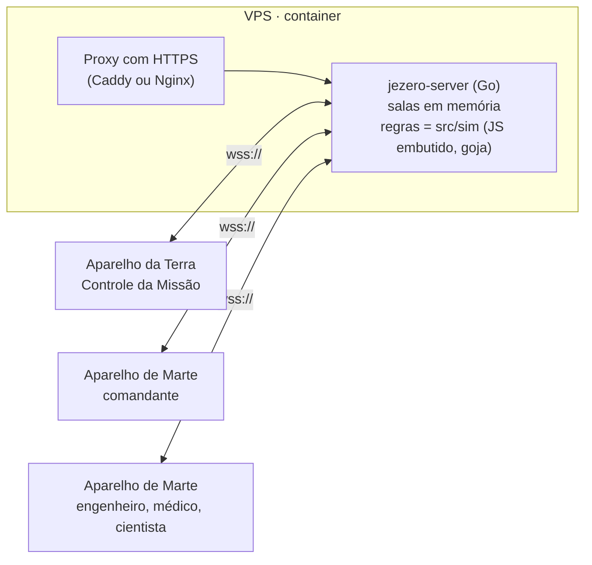
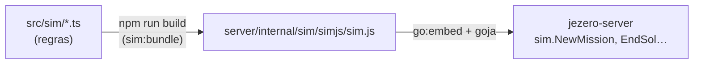

# Servidor do modo cooperativo (Go)

**Para jogar em grupo agora:** abra o link do servidor (seção [Onde está rodando](#onde-está-rodando)). Uma pessoa toca em **Jogar em grupo → Criar sala** e passa o código de 4 letras; as outras tocam em **Jogar em grupo**, digitam o código e escolhem um papel; quem criou a sala toca em **Começar a missão**.

O servidor em [`server/`](../server) manda nas partidas cooperativas online: guarda as salas, aplica as **mesmas regras do jogo solo** e manda para cada jogador só o que o papel dele pode ver.
Decisões: [ADR 0005](decisoes/0005-servidor-coop-em-go-com-as-regras.md) (servidor em Go, dono da partida) e [ADR 0006](decisoes/0006-servidor-roda-as-regras-do-typescript-goja.md) (as regras são o próprio `src/sim`, rodando dentro do Go). Regras do coop: [game-design.md](game-design.md#modo-cooperativo).



## Pastas

| Pasta | O quê |
| --- | --- |
| `server/internal/sim/` | Roda as regras de `src/sim/` (TypeScript empacotado em `simjs/sim.js`, executado com goja) e converte o estado para structs Go. **Não tem regra escrita em Go.** |
| `server/internal/coop/` | Modo coop: `game.go` (regras puras: papéis, vez da Terra, mensagens com atraso), `room.go` (sala, permissões, o que cada um vê), `hub.go` (salas abertas), `ws.go` (WebSocket). |
| `server/cmd/jezero-server/` | O programa: lê variáveis de ambiente, sobe o HTTP. |
| `server/Dockerfile`, `server/compose.yaml` | Container para o VPS. A imagem também compila e **serve o jogo**: um endereço só para jogo e coop. |
| `src/net/` | Cliente: `CoopClient.ts` (conexão, reconexão automática com token) e `protocol.ts` (tipos iguais aos do Go). |
| `src/ui/coop.ts` | Telas: escolher o modo, sala de espera (código, papéis, começar) e a vez da Terra. |

## Cliente (o jogo no navegador)

- O botão **Jogar em grupo** só aparece se o jogo souber o endereço do servidor, nesta ordem:
  1. `?coop=wss://…` na URL (útil com link temporário);
  2. `VITE_COOP_URL` no build: um `wss://…` fixo, ou `same-origin` (o jogo foi servido pelo próprio servidor coop; é o que a imagem Docker usa).
- Sem endereço, o jogo funciona só no modo solo, como antes.
- No modo em grupo, o jogo **não roda regras**: mostra o que o servidor manda e repassa decisões. A noite, o relatório e a tela final são os mesmos do solo.
- Cada jogador só mexe na parte da energia do seu papel; os outros botões ficam travados. "Terminar o sol" só para o comandante.
- Se a internet cair ou a página recarregar, o jogo volta sozinho para a mesma sala e o mesmo papel (token guardado na aba, `sessionStorage`).

## Regras do coop implementadas no servidor

| Regra | Como ficou |
| --- | --- |
| Papéis | `earth` (Terra), `commander`, `engineer` (blindagem), `medic` (vida), `scientist` (ciência). |
| Quem joga | O anfitrião (quem criou a sala) começa a partida. Precisa ter **comandante**. Papéis de Marte sem dono vão para o comandante. |
| Sem jogador na Terra | A Terra é automática: Marte recebe os avisos como no jogo solo. |
| Com jogador na Terra | Cada sol começa na **vez da Terra**: ela vê a previsão (hoje + **2 sóis**) e manda 1 mensagem da lista (`storm`, `dust`, `science`, `life`, `none`). A mensagem chega a Marte **no sol seguinte**, com atraso sorteado de 3 a 22 min. |
| Avisos em Marte com jogador na Terra | O aviso **antecipado** só vem da Terra. No dia da tempestade ou da poeira, o **alarme da base** dispara sozinho (`stormToday`, `dustNow`). *Decisão nossa: mantém a Terra essencial sem deixar a criança de Marte sem nenhum aviso. Ajustável em `MarsMessages()`.* |
| Energia | Cada papel só muda a sua parte. O total nunca passa dos blocos do sol. Se uma carta reduz os blocos, o plano é cortado (ciência, depois blindagem, depois vida). |
| Cartas, "Começar o dia", pausar e "Terminar o dia" | Só o comandante. |
| Dia em tempo real | O **relógio é do servidor**: ele abre cada problema no segundo sorteado e encerra o dia aos 75 s ou quando tudo foi consertado. Sem problemas no sol (sóis 1 e 2), "Começar o dia" vai direto para a noite, como no solo. |
| Consertar problemas | Qualquer jogador de Marte manda um astronauta na própria tela; o progresso e o "consertado" vão para o servidor, que aplica as regras (dose fora da base, consequência à noite). Dois jogadores consertando o mesmo problema: conta uma vez. |
| Missões históricas | Iguais ao solo: a primeira partida da sala usa uma missão de força média; as seguintes, qualquer uma. Sem `missions.json`, erupções sorteadas. |
| Antena desalinhada | Se ninguém consertou a antena, no sol seguinte Marte vê "sem sinal" e a mensagem da Terra **se perde**. |
| O que cada um vê | A Terra vê previsão, recursos e o relatório, **não** o plano. Marte vê o plano e as mensagens, **não** a previsão nem a agenda das tempestades (revelada no fim). |
| Dados pessoais | Nenhum: sem nome, sem conta, sem banco. Na tela, "Jogador 1..5". Tudo em memória; a sala some 15 min depois que todos saem. |

## Protocolo (WebSocket, JSON)

Endereço: `wss://<host>/ws`. Cada mensagem é um objeto com `t` (tipo).

**Cliente → servidor**

| `t` | Campos | Quem |
| --- | --- | --- |
| `create` | — | Qualquer um (vira anfitrião) |
| `join` | `code` (4 letras, sem vogais) | Qualquer um |
| `rejoin` | `code`, `token` | Quem caiu (o `token` veio no `welcome`) |
| `claim` / `release` | `role` | Na sala de espera |
| `start` | — | Anfitrião (também recomeça após o fim) |
| `earth` | `option` | Terra, na vez da Terra |
| `card` | `option` | Comandante |
| `blocks` | `key` (`life`, `shield`, `science`), `value` | Dono do papel da parte |
| `start_day` | — | Comandante ("Começar o dia"; sem problemas, vai direto para a noite). `end_sol` é sinônimo |
| `pause` / `end_day` | — | Comandante, na fase `day` |
| `problem_progress` | `uid`, `progress` (0–1) | Jogador de Marte, na fase `day` (o cliente manda no máximo ~4 por segundo) |
| `problem_resolve` | `uid` | Jogador de Marte, na fase `day` |

**Servidor → cliente**

| `t` | Conteúdo |
| --- | --- |
| `welcome` | `code`, `playerId`, `token` (guarde para reconectar) |
| `state` | A cada mudança (no dia, também a cada segundo do relógio): `phase` (`lobby`, `earth`, `mars`, `day`, `ended`), `you`, `players`, `autoEarth`, e `mars` e/ou `earth` conforme os papéis. O relatório do último sol vem em `mars.lastReport` / `earth.lastReport`. |
| `error` | `code`: `room_not_found`, `room_full`, `role_taken`, `need_commander`, `not_your_role`, `wrong_phase`, `card_pending`, `invalid`, `bad_token`, `server_full`, `too_fast` |

Limites: 5 jogadores por sala, 1.000 salas, mensagens de até 4 KB, 20 ações por segundo por conexão.

## Rodar no computador

Requisitos: Go 1.27+.

```bash
cd server
go test -race ./...                                  # ponte JS↔Go, coop, WebSocket
FLARES_PATH=../public/data/donki-flares.json MISSIONS_PATH=../public/data/missions.json go run ./cmd/jezero-server
curl localhost:8080/healthz                          # {"ok":true,"rooms":0,"realFlares":305,"historicalMissions":6}
```

| Variável | Padrão | O quê |
| --- | --- | --- |
| `PORT` | `8080` | Porta HTTP |
| `FLARES_PATH` | `data/donki-flares.json` | Erupções reais do DONKI (sem o arquivo, usa simuladas) |
| `MISSIONS_PATH` | `data/missions.json` | Missões históricas (sem o arquivo, erupções sorteadas) |
| `WEB_DIR` | `web` | Pasta com o jogo compilado; se existir, é servido em `/` (a imagem Docker já traz) |
| `ALLOWED_ORIGINS` | `localhost:*,127.0.0.1:*` | Hosts de onde o jogo pode conectar, separados por vírgula. Em produção, o host onde o jogo está publicado (ex.: `fronhaa.github.io`) |

## Link temporário (Cloudflare Quick Tunnel)

Para testar e demonstrar sem domínio próprio, o `compose.yaml` tem um túnel opcional do Cloudflare, sem conta:

```bash
docker compose --profile tunnel up -d
docker compose logs tunnel | grep trycloudflare.com    # o link do jogo
```

- O link (`https://<palavras>.trycloudflare.com`) abre o **jogo** e já conecta no coop.
- O link **muda** sempre que o container do túnel reinicia. Depois de reiniciar, pegue o link novo.
- Não tem garantia de disponibilidade: bom para hackathon e testes; para uso contínuo, use domínio próprio (abaixo).

## Onde está rodando

| O quê | Valor (14/11/2026) |
| --- | --- |
| Máquina | Workspace Coder `sisgeon/devs` (acesso: `coder ssh devs`) |
| Docker | Container separado `dind-devs` (variável `DOCKER_HOST`); a porta 8080 já é de outro serviço |
| Pasta | `~/jezero-coop` (cópia de `server/`, `src/`, `public/` e arquivos do Vite) |
| Containers | `jezero-coop` (porta `18095` no `dind-devs`) e `jezero-coop-tunnel` |
| Link | Ver no túnel: `docker logs jezero-coop-tunnel 2>&1 \| grep trycloudflare.com` |

Atualizar com o código da `main` (do seu computador, na raiz do repositório):

```bash
git archive main | coder ssh devs -- 'rm -rf ~/jezero-coop.new && mkdir ~/jezero-coop.new && tar -x -C ~/jezero-coop.new && rm -rf ~/jezero-coop && mv ~/jezero-coop.new ~/jezero-coop'
coder ssh devs -- 'cd ~/jezero-coop/server && COOP_BIND=0.0.0.0 COOP_PORT=18095 ALLOWED_ORIGINS="*.trycloudflare.com,localhost:*" docker compose up -d --build jezero-coop'
```

Assim só o `jezero-coop` é recriado; o túnel continua de pé e **o link não muda**.

## Subir no VPS (container)

```bash
git clone https://github.com/fronhaa/pi.git && cd pi/server
# Edite ALLOWED_ORIGINS em compose.yaml com o endereço onde o jogo está publicado.
docker compose up -d --build
docker compose ps            # deve aparecer "healthy"
```

O container escuta só em `127.0.0.1:8080`. Para o jogo conectar de uma página **https** (GitHub Pages), o navegador exige **`wss://`**: coloque um proxy com HTTPS na frente. Com Caddy, que pega o certificado sozinho:

```caddyfile
coop.seu-dominio.com.br {
    reverse_proxy 127.0.0.1:8080
}
```

Com Nginx, lembre dos cabeçalhos de WebSocket (`Upgrade` e `Connection "upgrade"`) e de um `proxy_read_timeout` de alguns minutos.

**Atualizar:** `git pull && docker compose up -d --build`. As salas abertas se perdem ao reiniciar (estão em memória), então atualize fora do horário de jogo.

## Regras: um lugar só (`src/sim`)

O servidor **não tem regra escrita em Go**. Ele executa a própria simulação do jogo ([ADR 0006](decisoes/0006-servidor-roda-as-regras-do-typescript-goja.md)):



**Mudou uma regra em `src/sim`?**

1. Rode `npm run build` (ou só `npm run sim:bundle`).
2. Commite o `server/internal/sim/simjs/sim.js` junto. O CI falha se ele estiver desatualizado.
3. Pronto: não precisa mexer em Go.

**Só precisa mexer em Go** se surgir campo novo em `src/sim/types.ts` que o servidor precise ler ou repassar aos jogadores.
Acrescente o campo em `server/internal/sim/types.go`; o teste `TestStateRoundTrip` (150 partidas aleatórias) aponta qualquer campo que se perder entre o JS e o Go.

Custo medido por sala: ~170 KB de memória, 0,4 ms para criar, 0,2 ms por ação. Cada sala tem o próprio motor JS.
